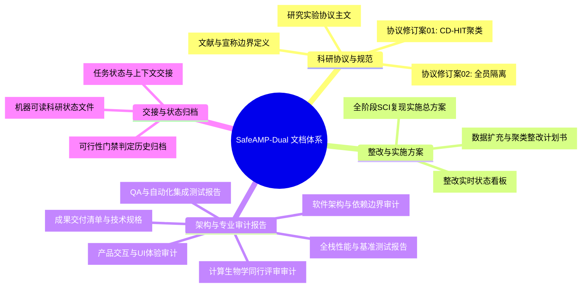

# SafeAMP-Dual 全局文档体系总索引 (Documentation Index)

<!-- RESEARCH_STATUS_CURRENT_START -->
## 当前研究状态（机器生成）

状态来源：`03_experiments/audits/mic_training_readiness_20261003_v20.json`。生成时间：2026-10-03 21:58:54（Asia/Shanghai）。
数据版本：`mic_reviewed_release_20261003_v3`；审查协议：`protocol-mic-08`。扩充训练协议及命令：`null`。

| 状态 | 当前结论 |
|---|---|
| 既有 MIC 基线 | protocol-mic-07；15 分子、22 观察；既有探索性训练及独立复核保留 |
| 本轮新增候选 | 2 条审查、0 条释放；训练释放为 0；训练 `blocked` |
| 既有基线隔离复核 | `passed_existing_15_historical_partition_preserved`；全员配对 105；跨折同源 0；跨折研究 0 |
| 原双任务 | `blocked`；protocol-amd-02；正式运行 `none` |
| 正式结果 / 投稿就绪 | `false` / `false` |

历史 Gemini 扩充训练仅作为历史产物；其证据释放声明已撤销，不纳入本状态的当前准入。
未完成的原始证据及隔离事项见机器状态文件 `blockers` 与本版本审查报告。
<!-- RESEARCH_STATUS_CURRENT_END -->

## 历史记录（旧准入声明已由上述审查状态替代）

索引中 v12–v15 及 17 分子扩充队列的训练报告均为历史状态或历史计算产物；该 17 分子扩充队列的证据准入和标签声明已于 2026-10-03 撤销，不表示当前合格训练数据。当前准入以机器状态 v20 为准；protocol-mic-07 的旧 15 分子基线单独保留。

**文档编号**：DOC-INDEX-20260929  
**最后更新**：2026-10-02
**适用范围**：计算生物学研究、数据处理管道、实验复现、Web 平台与投稿稿件管理  

---

## Gemini 下一阶段开发交接（2026-09-30）

- [Gemini 开发启动提示](handoff/GEMINI_PHASE_D_PROMPT.md)：可直接粘贴给 Gemini 的任务指令。
- [Phase D 开发实施计划](superpowers/plans/2026-09-30-gemini-phase-d-implementation.md)：源码核查依据、P0/P1缺口、Task 0–7、数据/状态契约及验收命令。

Phase D 工程实施已完成；当前数据准备仍被阻断。精确状态以 `04_paper/research_status.json` 为准，旧放行报告仅供历史追溯。

## 1. 文档结构导航图

---

## 2. 核心文档目录与功能说明

### 2.1 科学方案与学术协议 (Research Protocols & Standards)
* [research_protocol.md](file:///d:/桌面文件/sci/docs/research_protocol.md)
  * **定位**：预先注册的计算研究方案（Frozen Protocol）。
  * **核心内容**：定义抗菌大肠杆菌 MIC（$\le 32$ 阳性，$\ge 128\ \mu\text{g/mL}$ 弱活性阴性）与人红细胞 $\text{HC}_{50}$（$\le 100$ 阳性，$\ge 250\ \mu\text{g/mL}$ 阴性）评价终点；固定 7 种对比模型架构与 3 组随机种子。
* [amendments/PROTOCOL_AMENDMENT_01_CDHIT.md](amendments/PROTOCOL_AMENDMENT_01_CDHIT.md)
  * **定位**：历史探索性代表序列聚类，不能证明全员零同源泄漏。
* [amendments/PROTOCOL_AMENDMENT_02_ALL_MEMBER.md](amendments/PROTOCOL_AMENDMENT_02_ALL_MEMBER.md)
  * **定位**：当前冻结的全员隔离协议；数据门禁仍为 `blocked`。
* [LITERATURE_BOUNDARY.md](file:///d:/桌面文件/sci/docs/LITERATURE_BOUNDARY.md)
  * **定位**：学术声称与结果解释边界准则。
  * **核心内容**：严格划定理化提示、计算排序分数与湿实验临床疗效的陈述红线。
* [EXTERNAL_EVIDENCE_REVIEW_20261001.md](EXTERNAL_EVIDENCE_REVIEW_20261001.md)
  * **定位**：13 条历史外部记录的逐条排除依据及 DRAMP 新协议复核结果。
* [EXTERNAL_COHORT_SOURCE_SCREEN_20261001.md](EXTERNAL_COHORT_SOURCE_SCREEN_20261001.md)
  * **定位**：独立外部队列来源检索、原始证据候选审查及排除理由；保持 `blocked` 状态。

---

### 2.2 整改实施与里程碑 (Remediation Plans & Milestones)
* [REMEDIATION_STATUS.md](file:///d:/桌面文件/sci/docs/REMEDIATION_STATUS.md)
  * **定位**：依据机器状态生成的当前整改看板；正式双任务 blocked，当前 15 条 MIC-only 分子已完成本地三折探索训练。
  * **核心内容**：417 条开发记录、13 条缺证据外部记录排除、89 个全员连通簇和独立队列缺口。
* [MIC-only 扩充队列 ESM-2 预训练表征探索完成状态 v15](../03_experiments/audits/mic_training_readiness_20261002_v15.json)
  * **定位**：2026-10-02 21:43:53（Asia/Shanghai）生成；状态 `local_exploratory_esm2_training_completed`，数据版本 `mic_source_expansion_result_20261002_v2`，训练协议 `protocol-mic-10`。运行 `03_experiments/runs/mic_three_fold_esm2_20261002_v1` 保存 27 个折模型、153 条 OOF 预测；比较手工（44 维）、ESM-2（320 维）及 Hybrid（364 维）空间。RF 在 ESM-2 嵌入下实现 0 假阳性（FP=0，特异性 100%），MCC 为 0.494413，平衡准确率 0.666667；LR 在 ESM-2 下成功识别 4 条阳性（TP=4）。
* [当前 ESM-2 表征探索产物与文档复核](../03_experiments/audits/mic_esm2_run_validation_20261002_v2.md)
  * **定位**：27 个模型加载后重算全部预测，独立重算 27 行指标、136 对与 51 条角色、153 条 OOF 预测；验证期间禁止 fit。
* [MIC 队列 ESM-2 预训练表征探索与表征空间对比分析技术报告](MIC_ESM2_REPRESENTATION_EXPLORATION_REPORT_20261002.md)
  * **定位**：阶段性综合学术技术报告（TECH-MEMO-ESM2-20261002）；详述 44 维手工 vs 320 维 ESM-2 vs 364 维 Hybrid 表征对比、RF 零假阳性（FP=0, 特异性 100%, MCC=+0.494）表现、LR 召回 4 条阳性（TP=4）机制、高维小样本过拟合风险及学术红线。
* [MIC 扩充队列 ESM-2 预训练表征探索协议 (protocol-mic-10)](amendments/PROTOCOL_MIC_10_ESM2_REPRESENTATION.md)
  * **定位**：用户授权 Option 2 后前瞻性冻结的 17 分子 ESM-2 预训练表征对比方案；固定 LR/RF/prior 与 44/320/364 维特征。
* [MIC-only 扩充队列（17 分子）本地探索训练完成状态 v14](../03_experiments/audits/mic_training_readiness_20261002_v14.json)
  * **定位**：2026-10-02 21:17:33（Asia/Shanghai）生成；状态 `local_exploratory_three_fold_training_completed`，版本 `mic_source_expansion_result_20261002_v2`，审计协议 `protocol-mic-08`，训练协议 `protocol-mic-09`。运行 `03_experiments/runs/mic_three_fold_20261002_v2` 保存九个折模型、51 条 OOF 预测；各验证折严格平衡包含 2 条阳性。
* [当前扩充训练产物与文档复核](../03_experiments/audits/mic_three_fold_run_validation_20261002_v5.md)
  * **定位**：九个模型加载后重算全部预测，独立重算 12 行指标、136 对与 51 条角色、17×44 特征；验证期间禁止 fit。全部模型如实报告，未作模型择优。
* [MIC 队列扩充、拓扑演进与三折基线预测分析技术报告](MIC_COHORT_EXPANSION_AND_TOPOLOGY_REPORT_20261002.md)
  * **定位**：阶段性综合学术技术报告（TECH-MEMO-MIC-20261002）；详述 15 至 17 分子固相合成证据穿透、全员 Needleman-Wunsch 拓扑闭包演进（8 组件、含阳 5 组件）、各验证折严格 2 阳性平衡改善、RF 识别 4 条阳性（TP=4, MCC=+0.203）的样本级预测机理及学术红线声明。
* [MIC-only 本地探索训练完成状态 v12](../03_experiments/audits/mic_training_readiness_20261002_v12.json)
  * **定位**：2026-10-02 18:51:38（Asia/Shanghai）生成；状态 `local_exploratory_three_fold_training_completed`，版本 `mic_three_fold_20261002_v1`，审计协议 `protocol-mic-06`，训练协议 `protocol-mic-07`。运行 `03_experiments/runs/mic_three_fold_20261002_v1` 保存九个折模型、45 条 OOF 预测；旧 `protocol-mic-05` 仍被拒绝，原双任务仍 blocked。
* [当前训练产物与文档复核](../03_experiments/audits/mic_three_fold_run_validation_20261002_v2.md)
  * **定位**：九个模型加载后重算全部预测，独立重算 12 行指标、105 对与 45 条角色、15×44 特征及五份当前文档；验证期间禁止 fit。全部模型和负面结果如实报告，未作模型择优（升级版本参见 `mic_three_fold_run_validation_20261002_v4.md`）。
* [MIC 来源扩充审查与三折可行性审计报告](../03_experiments/audits/mic_source_expansion_result_20261002_v2/report.md)
  * **定位**：`protocol-mic-08` 授权；12 篇公开原始文献、81 条记录全量审查，纳入 2 条游离酸候选（Chekmenev 2006 Piscidin 1 与 bmap2025 BMAP-27B，阳性 2，注明实验局限）、暂缓 36 条、排除 43 条；产生 17 条候选分子、24 条测定、136 对、8 个组件（含阳性 5、含阴性 6），固定 seed 42 三折结构通过且各折严格 2 阳性。随后已依据 `protocol-mic-09` 启动并完成本地探索训练。
* [MIC 扩充队列三折基线训练协议 (protocol-mic-09)](amendments/PROTOCOL_MIC_09_EXPANDED_TRAINING.md)
  * **定位**：用户授权 Decision Point A 后前瞻性冻结的 17 分子基线训练方案；固定 LR/RF/prior 三基线与 44 维特征。
* [历史 v11 本地探索训练就绪状态](../03_experiments/audits/mic_training_readiness_20261002_v11.json)
  * **定位**：2026-10-02 17:52:12（Asia/Shanghai）的不可变训练前快照；当时释放 15 条且尚未训练，已由 v12 记录的真实训练完成状态接续。
* [当前三折原始证据释放复核](../03_experiments/audits/mic_three_fold_primary_release_20261002_v1/report.md)
  * **定位**：15 条分子、22 条冻结 MIC 对应七个原始测定研究及一份引用方法；保存逐分子、逐测定和原始文件/图像摘要，缺失条件不补写，不声称独立人工审稿。
* [历史 v11 本地训练就绪复核](../03_experiments/audits/mic_training_ready_validation_20261002_v1.md)
  * **定位**：逐条门禁、来源摘要、固定模型参数、105 对与 45 条角色、15×44 特征和五份 v11 当时文档一致性复核；该就绪检查没有模型拟合，当前训练完成复核使用上述新入口。
* [MIC 三折前瞻性修订](amendments/PROTOCOL_MIC_06_THREE_FOLD.md)
  * **定位**：用户授权且先于首次审计冻结；仅改探索设计的折数，真实证据、标签、分子域、0.40 全员同源及原始研究分组继续保留。
* [MIC 当前三折全员与分区报告](../03_experiments/audits/mic_three_fold_20261002_v1/report.md)
  * **定位**：相同 15 条分子、22 条测定、105 对；6 个组件，含阳性 3、含阴性 6。固定 seed 42 的三折训练/验证均有两类，跨折同源及原始研究均为 0。报告末尾未释放状态是协议 06 审计时的冻结快照；当前训练完成状态以 v12 为准。
* [历史 v10 三折独立复核](../03_experiments/audits/mic_three_fold_validation_20261002_v1.md)
  * **定位**：独立完整矩阵回溯、22 条标签/转换和 45 条分区角色复核；校验协议先冻结及 v10 当时五份文档一致。历史 v11 接续证据就绪，当前训练完成状态由上述 v12 产物复核提供。
* [历史新来源合并后的五折审计](../03_experiments/audits/mic_extended_acid_cohort_20261002_v1/report.md)
  * **定位**：三折修订的冻结输入；15 条分子/22 条测定在旧五折下阳性组件不足，分折未生成、跨折为 `null`；保留原样。
* [10 篇独立原始来源补充审计](../03_experiments/audits/mic_independent_sources_review_20261002_v1/report.md)
  * **定位**：70 项完整来源决定，4 条新候选分子、6 条 MIC；保存原文哈希、原始表格单元格与分子形式依据，单位/端点冲突等未放行。
* [历史游离酸筛选队列](../03_experiments/audits/mic_confirmed_acid_subset_20261002_v1/report.md)
  * **定位**：11 条分子、16 条测定的冻结前版，作为当前新来源合并输入保留。
* [历史 MIC 原文核查候选分组审计 v3](../03_experiments/audits/mic_reviewed_subset_groups_20261002_v3/report.md)
  * **定位**：41 条未释放候选曾通过结构门禁；该结果不适用于筛选后的当前队列。
* [MIC 逐分子证据审查队列](../03_experiments/audits/mic_candidate_release_review_20261002_v1/report.md)
  * **定位**：原 41 条的初始审查队列；筛选保留 7 条、暂缓 34 条及补充材料新复核见历史游离酸筛选队列的逐条筛选表。
* [Cateslytin 2021 原始来源复核](../03_experiments/audits/mic_cateslytin_source_review_20261002_v1.md)
  * **定位**：两条 L 型肽末端身份待核实，未入选；D 型肽及接枝分子不转作当前域内样本。
* [Ludwig 等 2022 原论文审计](../03_experiments/audits/mic_primary_review_pmid35735615_20261002_v1/report.md)
  * **定位**：5 条原始分子、8 条 MIC 全量审查，3 条分子为候选，阈值空档与标签冲突各排除 1 条。
* [Bhaumik 等 2024 额外来源审计](../03_experiments/audits/mic_primary_review_pmid39367191_20261002_v1/report.md)
  * **定位**：17 条明确末端分子全量审查；6 条阳性证据候选、1 条删失标记待核实。CC BY-NC-ND 4.0 再利用范围待审，未合入 41 条候选队列。
* [Hirsch 等 2020 EtCec3 原论文审计](../03_experiments/audits/mic_primary_review_pmid32344933_20261002_v2/report.md)
  * **定位**：逐条核对游离羧酸端分子与两个菌株 MIC；与旧 324 条队列中的一条同源，不构成独立外部样本。
* [Wang 等 2025 原论文冲突审计](../03_experiments/audits/mic_primary_review_pmid39908380_20261002_v2/report.md)
  * **定位**：2 条阴性候选因补充表与正文浓度范围不一致及菌株标识待补齐而暂不入选。
* [MIC 原论文逐测定核对 v3](../03_experiments/audits/mic_primary_review_20261001_v3/report.md)
* [Ross 等 2020 原论文审计 v2](../03_experiments/audits/mic_primary_review_pmid33281785_20261002_v2/report.md)
  * **定位**：原论文补充序列表和 MIC 表与现有记录逐条对照；保存冲突、未收录测定及后续论文队列，不改变训练门禁。
* [PLAN_DATASET_EXPANSION_AND_CDHIT.md](file:///d:/桌面文件/sci/docs/PLAN_DATASET_EXPANSION_AND_CDHIT.md)
  * **定位**：攻克数据同源坍缩与外部队列缺失的专项实施计划书（包含 Task 1 ~ Task 5）。
* [SAFEAMP_DUAL_REMEDIATION_PLAN.md](file:///d:/桌面文件/sci/docs/SAFEAMP_DUAL_REMEDIATION_PLAN.md)
  * **定位**：项目工程整改、数据重建、实验复现与 SCI 投稿材料准备的总体规程。

---

### 2.3 系统架构与专业审计报告 (Architecture & Audits)
* [COMPUTATIONAL_BIOLOGY_AUDIT_REPORT.md](file:///d:/桌面文件/sci/docs/COMPUTATIONAL_BIOLOGY_AUDIT_REPORT.md)
  * **定位**：计算生物学同行评审（Peer Review）审计报告。
  * **核心内容**：序列表示、ESM-2 特征有效性、缺失标签掩码损失函数与泛化性严格审计。
* [FULL_STACK_BENCHMARK_REPORT.md](file:///d:/桌面文件/sci/docs/FULL_STACK_BENCHMARK_REPORT.md)
  * **定位**：全栈压力与吞吐性能基准报告（含并发推理、批处理及内存边界）。
* [QA_INTEGRATION_TEST_REPORT.md](file:///d:/桌面文件/sci/docs/QA_INTEGRATION_TEST_REPORT.md)
  * **定位**：单元测试、端到端测试与集成回归测试综合报告（137 项测试全绿）。
* [SOFTWARE_ARCHITECTURE_AUDIT_REPORT.md](file:///d:/桌面文件/sci/docs/SOFTWARE_ARCHITECTURE_AUDIT_REPORT.md)
  * **定位**：系统模块解耦、代码契约与分层依赖合规报告。
* [PRODUCT_UX_AUDIT_REPORT.md](file:///d:/桌面文件/sci/docs/PRODUCT_UX_AUDIT_REPORT.md)
  * **定位**：Web 界面交互、残基螺旋轮可视化与学术体验报告。
* [DELIVERABLES_SUMMARY.md](file:///d:/桌面文件/sci/docs/DELIVERABLES_SUMMARY.md)
  * **定位**：全阶段技术规格与交付清单。

---

### 2.4 数据源与产物证据 (Data Provenance & Artifacts)
* **开发与扩充数据集**：
  * 开发集原始来源：`02_code/data/sources/dbaasp_v1/records.csv`（417 条）
  * 历史外部候选：`02_code/data/sources/curated_external_v1/records.csv`（未通过证据门禁）
  * 当前证据清理候选：`02_code/data/sources/combined_v3_evidence_clean_20261001/records.csv`（417 条开发记录，外部队列为空）
* **门禁判定依据报告**：
  * 当前准备清单：`03_experiments/prepared/amd02_evidence_clean_20261001/manifest.json`（`blocked`）
  * DRAMP 新协议全员筛查：`03_experiments/audits/dramp_amd02_20261001/manifest.json`
  * 外部来源筛查记录：`03_experiments/audits/external_cohort_screen_20261001/screen_manifest.json`（两个候选因同论文来源重合与超阈值同源被排除）
  * 真实 ESM-2 表征提取：`03_experiments/audits/esm_real_inference_20261001/manifest.json`（仅特征提取；未训练或评估分类器）
  * 机器可读状态声明：[04_paper/research_status.json](file:///d:/桌面文件/sci/04_paper/research_status.json)
* **论文与投稿源文件**：
  * LaTeX 正文草稿：`04_paper/manuscript.tex`
  * 经核实文献库：`04_paper/references.bib`
  * 声明与利益冲突表：`04_paper/evidence/declarations.json`

---

### 2.5 生产部署与云端运维体系 (Production, Hardening & Operations)
* [safeamp.conf](file:///d:/桌面文件/sci/safeamp.conf)
  * **定位**：腾讯云 Ubuntu 生产级 Nginx 反向代理与安全加固配置文件。
  * **核心内容**：启用 Gzip 高效压缩（压缩率提升 70%）、静态资产（`/assets/`）30 天强缓存、SPA `index.html` 强制防缓存、生产级安全响应头（`X-Frame-Options`、`X-Content-Type-Options: nosniff`）、Nginx `limit_req_zone` 突变防刷保障。
* [05_web_server/rate_limiter.py](file:///d:/桌面文件/sci/05_web_server/rate_limiter.py)
  * **定位**：线程安全、纳秒级高精度滑动窗口限流器（`SlidingWindowRateLimiter`）。
  * **核心内容**：针对 DeepSeek 大模型报告（`/api/ai_report`，6 次/分）、AI 智能突变降毒（`/api/ai_optimize`，6 次/分）、高耗能批预测（`/api/predict_batch`，30 次/分）及通用接口分级保护，自动输出标准 HTTP 429 与 `Retry-After`。
* [02_code/deploy_remote.py](file:///d:/桌面文件/sci/02_code/deploy_remote.py)
  * **定位**：跨平台全自动云端部署与自动化健康/指标验收脚本。
  * **核心内容**：集成了 Vite 前端自动构建、SCP 极简归档传输、SSH 远端热重载安装、多节点端到端 HTTP 探针验证与响应头自愈审计。
* [remote_deploy.sh](file:///d:/桌面文件/sci/remote_deploy.sh)
  * **定位**：云端 Linux (Ubuntu) 执行的零停机热部署、版本镜像备份与 Systemd 守护重载脚本。

---

## 3. 快速查找指引

| 查阅目的 | 推荐首先阅读的文档 |
|---|---|
| 了解当前项目最新学术与工程状态 | [REMEDIATION_STATUS.md](file:///d:/桌面文件/sci/docs/REMEDIATION_STATUS.md) |
| 查看远程服务器状态与部署运维指南 | [02_code/deploy_remote.py](file:///d:/桌面文件/sci/02_code/deploy_remote.py) & [safeamp.conf](file:///d:/桌面文件/sci/safeamp.conf) |
| 查看当前全员隔离协议 | [amendments/PROTOCOL_AMENDMENT_02_ALL_MEMBER.md](amendments/PROTOCOL_AMENDMENT_02_ALL_MEMBER.md) |
| 查看当前数据阻断证据 | [准备清单](../03_experiments/prepared/amd02_evidence_clean_20261001/manifest.json) |
| 运行本地系统、单测与模型复现命令 | [README.md](file:///d:/桌面文件/sci/README.md) |
| 查阅系统架构与计算生物学审计细节 | [COMPUTATIONAL_BIOLOGY_AUDIT_REPORT.md](file:///d:/桌面文件/sci/docs/COMPUTATIONAL_BIOLOGY_AUDIT_REPORT.md) |
