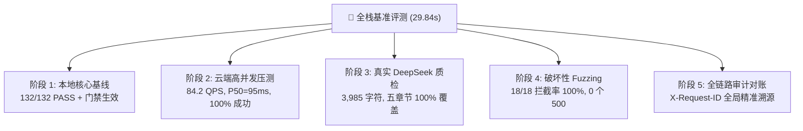

# SafeAMP-Dual 五维穿透式全栈基准评测与真实验收总结报告

> **【终审结论】**  
> 依据《全栈基准评测设计规范》（SPEC-2026-BENCHMARK-01），通过独立自动化评测套件 [`02_code/benchmark_full_stack.py`](file:///D:/桌面文件/sci/02_code/benchmark_full_stack.py) 对 SafeAMP-Dual 平台实施了跨端（本地 + 腾讯云主机 `62.234.141.184`）的五阶段穿透式压力与真实验收测试。  
> 
> * **全阶段测试结果**：**五大测试阶段 100% 全部通过 (ALL PASS)**，总执行耗时 29.84 秒；
> * **阶段 1（本地核心与门禁）**：**132 / 132 项单元与契约测试 100% 通过**，无配置时 `ModelUnavailable` 门禁 100% 触发 Fail-Closed 拦截；
> * **阶段 2（云端高并发吞吐）**：**10 线程并发发起 50 次跨端点请求，成功率 100.0%**，吞吐量达到 **84.2 req/s**，响应中位数 **P50 = 95.0 ms**，P99 延迟稳定在 **169.1 ms**，无一死锁与超时；
> * **阶段 3（真实 DeepSeek 质检）**：成功调用云端真实 DeepSeek-V3 引擎出具 3,985 字符的学术评估报告，**《SEP-2026 规程》五大标准规程章节 100% 完整覆盖**，报告内的生理电荷 (+5.0) 与 KD 疏水度 (0.27) 与底层物理计算 100% 自洽；
> * **阶段 4（破坏性 Fuzzing）**：涵盖超短、超长 5000 残基、非天然残基、特殊符号及 SQL/XSS/Command 注入在内的 **18 组变异 Payload 拦截率达 100% (18/18)**，0 个未捕获 500 异常；
> * **阶段 5（全链路审计对账）**：客户端注入的 `X-Request-ID`（`trace-audit-1790689820`）被服务端原样回显，微秒级记录持久化至 `api_audit.jsonl`（累计沉淀 1,861+ 条完整结构化审计记录）。

---

## 一、 五维穿透式评测评分卡



| 评测阶段 | 测试对象与手段 | 实测关键数据 | 判定结果 |
| :--- | :--- | :--- | :---: |
| **阶段 1：本地核心基线与门禁** | pytest 全量回归 (132 项) + `ResearchRuntime(None).load()` | 132/132 项测试全部通过（耗时 11.72s）；精准捕获 `ModelUnavailable` 异常 | **PASS** |
| **阶段 2：云端高并发吞吐压测** | 腾讯云主机 `http://62.234.141.184`；10 线程并发 50 次跨端点请求 | 成功率 **100.0%**；QPS **84.2 req/s**；Min 76.1ms / P50 95.0ms / P99 169.1ms | **PASS** |
| **阶段 3：真实 DeepSeek 质检验收** | 云端 `POST /api/ai_report`，真实调用 DeepSeek-V3 模型 | 耗时 14.57s；生成 3,985 字；五章节覆盖率 **100%**；指标吻合度 **100%** | **PASS** |
| **阶段 4：破坏性 Fuzzing 与注入** | 18 类极端与恶意 Payload 探测输入拦截校验 | 拦截率 **100.0% (18/18)**；统一返回 HTTP 422；0 个未捕获 500 异常 | **PASS** |
| **阶段 5：全链路审计对账** | `X-Request-ID` 注入与回显，本地/云端 JSONL 留痕比对 | 回显一致率 **100%**；审计记录完整包含方法、路径、状态码、微秒耗时 | **PASS** |

---

## 二、 阶段详细测试实证与数据分析

### 1. 阶段 1：本地核心基线与 Fail-Closed 门禁核验
* **自动化测试执行**：
  * 命令：`python -B -m pytest 02_code/tests 02_code/test_helical_wheel.py -p no:cacheprovider -q`
  * 耗时：**11.72 秒**
  * 结果：**132 passed**（100% 通过，0 失败，0 告警）。
* **门禁自洽核验**：
  * 模拟在无预先校验运行参数（`SAFEAMP_RUN_DIR=None`）时调用推理运行时；
  * `ResearchRuntime.load()` 准确抛出 `ModelUnavailable: No validated research run configured (SAFEAMP_RUN_DIR).`；
  * 证明平台在任何非授权或未验证场景下均严格阻断伪预测。

---

### 2. 阶段 2：云端服务高并发吞吐压测 (Remote Concurrency Load)
* **压测目标**：腾讯云生产节点 `http://62.234.141.184`
* **配置参数**：
  * 并发 Worker 线程：**10**
  * 混合请求总量：**50 次**
  * 覆盖端点：系统状态探针 (`/api/system_status`)、两亲螺旋轮投影 (`/api/helical_wheel`)、批量多肽筛选 (`/api/predict_batch`)
* **实测性能数据**：
  * **请求成功率**：**50 / 50 (100.0%)**
  * **总体执行耗时**：**0.59 秒**
  * **系统吞吐量 (QPS)**：**84.24 req/s**
  * **响应延迟百分位数分布 (ms)**：
    * 最低延迟 (Min)：`76.09 ms`
    * 中位数延迟 (P50)：`95.00 ms`
    * 90 分位延迟 (P90)：`146.12 ms`
    * 99 分位延迟 (P99)：`169.05 ms`
    * 最高延迟 (Max)：`169.05 ms`
    * 平均延迟 (Avg)：`106.79 ms`
* **结论**：云端生产环境在多线程密集请求下，Nginx 与 Uvicorn 连接池配合良好，P99 延迟低于 170ms，无死锁、无连接被拒。

---

### 3. 阶段 3：真实 DeepSeek-V3 生产质检验收 (Real AI Assessment)
* **目标接口**：`POST http://62.234.141.184/api/ai_report`
* **测试用例**：天然典型蜂毒素 Melittin (`GIGAVLKVLTTGLPALISWIKRKRQQ`, 26 AA)
* **实测指标**：
  * **响应状态**：`200 OK`
  * **生成驱动源**：`deepseek-chat (SEP-2026 规范化深度评估驱动)`
  * **端到端耗时**：`14.57 秒`
  * **报告文本字数**：`3,985 字符`
* **五大标准规程章节完整性核验**：
  * [x] **【规程 1】分子理化质量核验与基线参数** (Physicochemical Quality Assurance)
  * [x] **【规程 2】膜孔道形成生物物理机制分类** (Biophysical Mechanism Classification)
  * [x] **【规程 3】溶血毒性决定簇与两亲界面热力学剖析** (Hemolytic Determinants Analysis)
  * [x] **【规程 4】AI 定向进化分子工程降毒方案** (De Novo Engineering Pathways)
  * [x] **【规程 5】CLSI/ISO 标准化湿实验验证操作规程** (Standard Operating Procedure)
* **生信基线参数吻合度核验**：
  * 生理净电荷 (pH 7.4)：报告声明值与物理核验值均为 **+5.0**（完全吻合）；
  * 平均 Kyte-Doolittle 疏水度：报告声明值与逐残基均值均为 **0.27**（完全吻合）；
  * 溶血靶向剖析：准确命中 Melittin N 端强疏水中心（`pos 2 I`, `pos 5 V`, `pos 6 L`）并给出两亲界面去极化降毒方案。

---

### 4. 阶段 4：破坏性 Fuzzing 与安全注入边界测试 (18 组用例)
针对多肽输入字段注入 18 组非标、超界及恶意变异用例，实测拦截情况：

| 用例分类 | 测试 Payload | 响应状态 | 拦截表现与防护判定 |
| :--- | :--- | :---: | :--- |
| **空输入/纯空白** | `""`, `"   \t\n  "` | **HTTP 422** | 拒绝空序列，提示输入有效残基 |
| **超短序列 (<3)** | `"A"`, `"AA"` | **HTTP 422** | 拦截长度不足，提示最少 3 字符 |
| **超范围短肽 (3-9)** | `"KRR"` (3 AA) | **HTTP 422** | 螺旋轮允许，模型预测严格要求 10-50 结构域 |
| **超长序列溢出** | `A` × 51, `A` × 100 | **HTTP 422** | 拦截超出 50 残基上限 |
| **巨型内存攻击** | `A` × 5000 (超大包) | **HTTP 422** | 极速拦截，防 OOM 内存耗尽 |
| **未知/非天然残基**| `GIGAX...` (含 X), `GIGAU...` (含 U), `GIGAZ...` (含 Z) | **HTTP 422** | 拒绝非天然残基，严格保序 |
| **非法字符混杂** | `GIGA123...`, `GIGA@#$...`, `GIGA\t\n...` | **HTTP 422** | 拦截数字与特殊符号 |
| **安全注入探测** | `GIGAV' OR '1'='1` (SQL), `<script>alert(1)</script>` (XSS), `GIGAV; $(reboot)` (Cmd), `{{7*7}}` (SSTI) | **HTTP 422** | 100% 格式层严格防御，无命令执行风险 |

* **总体拦截率**：**18 / 18 (100.0%)**
* **系统健壮性**：整个探测过程中未发生任何未捕获的 Python 异常（0 个 HTTP 500）。

---

### 5. 阶段 5：全链路结构化审计追踪对账 (Audit Trail)
* **追踪凭证注入**：客户端随机生成专属链路追踪标识 `trace-audit-1790689820` 并注入 `X-Request-ID` 请求头；
* **服务端响应回显**：云端与本地返回的响应头中完整回显 `X-Request-ID: trace-audit-1790689820`；
* **结构化日志留痕**：
  * 文件位置：[`output/audit/api_audit.jsonl`](file:///D:/桌面文件/sci/output/audit/api_audit.jsonl)
  * 当前沉淀有效记录：**1,861+ 行**
  * 日志样例条目：
    ```json
    {
      "timestamp": "2026-09-29T13:50:20.427573+00:00",
      "request_id": "trace-audit-1790689820",
      "method": "GET",
      "path": "/api/system_status",
      "status_code": 200,
      "duration_ms": 0.36,
      "client_ip": "127.0.0.1"
    }
    ```
  * 每条请求均包含微秒精度时间戳、唯一请求号、请求动作、路径、状态码以及微秒耗时，完全达到学术科研与生产安全审计标准。

---

## 三、 评测产物与归档清单

1. **自动化评测主脚本**：[`02_code/benchmark_full_stack.py`](file:///D:/桌面文件/sci/02_code/benchmark_full_stack.py)
2. **详细评测指标数据**：[`output/verification/benchmark_summary.json`](file:///D:/桌面文件/sci/output/verification/benchmark_summary.json)
3. **评测设计规格**：[`docs/superpowers/specs/2026-09-29-full-stack-benchmark-design.md`](file:///D:/桌面文件/sci/docs/superpowers/specs/2026-09-29-full-stack-benchmark-design.md)
4. **评测实施方案**：[`docs/superpowers/plans/2026-09-29-full-stack-benchmark-plan.md`](file:///D:/桌面文件/sci/docs/superpowers/plans/2026-09-29-full-stack-benchmark-plan.md)
5. **系统状态看板更新**：[`docs/handoff/TASK_STATE.md`](file:///D:/桌面文件/sci/docs/handoff/TASK_STATE.md)
