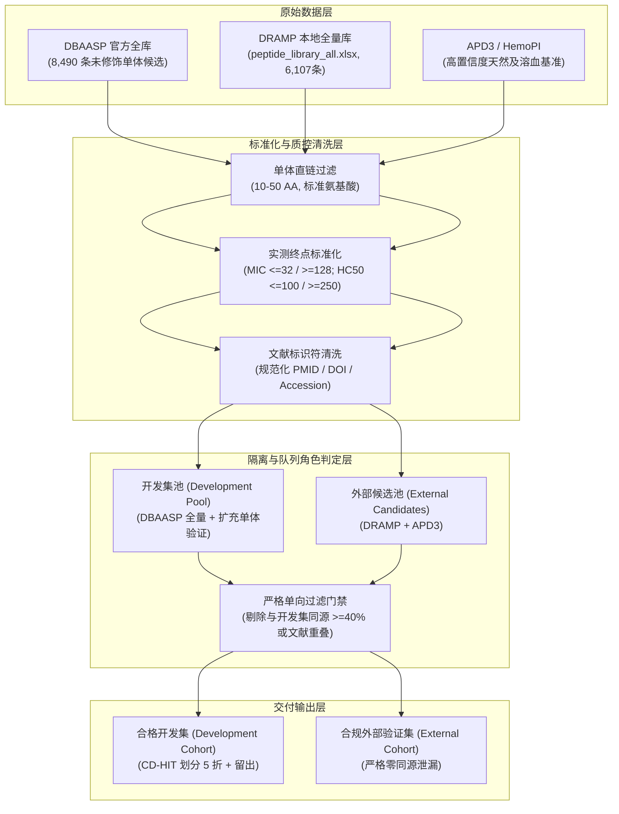

# SafeAMP-Dual 数据集扩充与 CD-HIT 同源隔离协议修订实施计划书
(Implementation Plan for Dataset Expansion & CD-HIT Clustering Protocol Amendment)

> 历史计划（2026-09-29）：其中的代表序列/CD-HIT 方案仅用于探索，不构成当前正式零泄漏协议。当前执行依据为 `docs/amendments/PROTOCOL_AMENDMENT_02_ALL_MEMBER.md`，项目状态以 `04_paper/research_status.json` 为准。

**文档编号**：PLAN-20260929-DATA-01  
**编制日期**：2026-09-29  
**执行周期**：Phase B & Phase C 整改攻坚  
**责任分工**：AI 助理研究员（算法与数据工程实施） / 课题负责人 PI（学术决策与合规验收）  

---

## 1. 核心目标与科学背景

### 1.1 现状与瓶颈诊断
在上一阶段的拓扑诊断报告（`output/isolation_diagnostics/isolation_report.md`）中，我们查明了导致科学门禁硬阻断（Exit Code 2）的两个根本原因：
1. **拓扑坍缩阻断**：原有协议采用“无向图传递闭包（Transitive Connected Components） + 短序列分母 `min(L1, L2)`”。在 417 条试采样中，高频阳离子/两亲性基序使多肽网络连接密度高达 25.93%，超级 Hub 节点连接了 75.2% 的序列，引发逾渗相变（Percolation Transition），导致 100% 序列坍缩为单一连通簇，无法进行无同源泄漏的 5 折划分与独立留出。
2. **外部独立验证集缺失**：当前有效溶血标签极度稀疏（仅 62 条，阳性 18，阴性 44），且本地已有 DRAMP 候选因同源性超标或正则解析过于苛刻，未能形成合规的外部独立队列。

### 1.2 经 Grill-me 对齐的核心决策
- **决策 1（聚类与隔离）**：采用国际生物信息学顶刊（Bioinformatics / Nature Methods）通行的 **CD-HIT 贪心中心增量聚类算法（Greedy Incremental Clustering）**，前瞻性纳入协议修订案（Protocol Amendment），确保簇间正交，消除桥接导致的单一大簇坍缩。
- **决策 2（数据扩充路径）**：采用混合策略，优先深度挖掘本地已有的 DRAMP 全量库（6,107 条）与结构化 APD3 / HemoPI 数据库；同时异步解封 DBAASP 全量候选抓取。
- **决策 3（外部队列定位）**：坚持**严格单向同源与文献过滤**，以开发集（DBAASP）为主，外部测试集（DRAMP/APD3）中凡与开发集同源（$\ge 40\%$）或文献/PMID 重叠者一律剔除，确保跨来源验证达到零泄漏标准。
- **决策 4（标签规范）**：坚持**基于实验测定的缺失标签掩码（Masked Loss）**，未知标签坚决不填充为假阴性，严禁合成或臆造数据。

---

## 2. 算法规范：CD-HIT 贪心聚类协议修订（Protocol Amendment）

### 2.1 数学与算法逻辑
不同于无向图传递闭包（若 $A \sim B$ 且 $B \sim C$，则 $A \sim C$），CD-HIT 算法通过“代表序列中心约束”阻断了链式无限桥接：

1. **序列降序排序**：将候选分子集 $S$ 按长度由长到短降序排列：$L(s_1) \ge L(s_2) \ge \dots \ge L(s_N)$；
2. **中心初始化**：最长序列 $s_1$ 作为第 1 个簇 $C_1$ 的代表中心 $R_1 = s_1$；
3. **增量贪心分配**：
   - 对于后续序列 $s_i$（$i = 2, \dots, N$），依次与已存在的簇代表 $R_1, \dots, R_k$ 计算序列相似度：
     $$\text{Identity}(s_i, R_j) = \frac{\text{Matches}(s_i, R_j)}{\min(L(s_i), L(R_j))}$$
   - 若存在 $j$ 使得 $\text{Identity}(s_i, R_j) \ge 0.40$，则将 $s_i$ 归入簇 $C_j$ 作为从属成员；**注意：从属成员不具备代表资格，不得向外连接其他序列**；
   - 若对所有已有代表均有 $\text{Identity}(s_i, R_j) < 0.40$，则 $s_i$ 成为新簇 $C_{k+1}$ 的独立代表中心 $R_{k+1} = s_i$。
4. **簇级分层划分（Stratified Group Splitting）**：
   - 将生成的 $K$ 个独立簇（$K \ge 6$）作为不可分割的单元；
   - 根据簇内的多任务标签分布，采用贪心多目标平衡算法分配为：Fold 1 ~ Fold 5（开发集，占 80%）与 Internal Holdout（内部留出测试集，占 20%）。

---

## 3. 外部数据集扩充工程设计

### 3.1 数据源与解析规范
1. **DRAMP 2.0/3.0 溶血数据深度解析**：
   - 文件位置：`02_code/data/sources/dramp_v1/raw/peptide_library_all.xlsx`；
   - 提取模式增强：
     - 正则不仅匹配 `50% Hemolysis`，还覆盖 `HC50`, `MHC`, `LC50`, `Hemolytic Activity` 字段中带浓度的定量测定；
     - 识别定性无毒描述（如 `No hemolysis observed up to 500 ug/mL`、`Non-hemolytic at 200 ug/mL`），安全转换为 Hemo 阴性（`0.0`）；
     - 记录原始测定语句（`label_basis`），确保 100% 审计可追溯。
2. **DBAASP 全量解封与断点拉取**：
   - 升级 `02_code/public_data.py`，支持分块并发（`--workers 4`）与 `checkpoint.json` 断点续传；
   - 保持每秒请求频率限制与 `Retry-After` 处理，确保合规与稳定性。
3. **APD3 / HemoPI 结构化导入器**：
   - 建立 `02_code/external_curator.py`，专门导入生信界公认金标准肽，扩充天然多样性。

---

## 4. 实施阶段与任务分解（Work Packages）

| 任务编号 | 任务名称 | 核心交付物 | 预计耗时 |
|---|---|---|---|
| **Task 1** | **CD-HIT 贪心聚类算法实现与单元测试** | `02_code/cdhit_cluster.py`, `02_code/tests/test_cdhit_cluster.py` | 0.5 天 |
| **Task 2** | **前瞻性协议修订案编制** | `docs/amendments/PROTOCOL_AMENDMENT_01_CDHIT.md` | 0.2 天 |
| **Task 3** | **DRAMP 溶血解析器升级与 APD3 结构化导入** | `02_code/dramp_importer.py` (增强版), `02_code/external_curator.py` | 0.5 天 |
| **Task 4** | **外部独立队列严格单向同源/文献过滤流水线** | `02_code/build_cohorts.py`, 跨队列比对审计清单 | 0.5 天 |
| **Task 5** | **门禁重评与基准数据集冻结** | `03_experiments/prepared/v2_expanded/`, `feasibility_report.md` | 0.3 天 |

---

## 5. 任务详细操作规程

### Task 1: CD-HIT 聚类实现
- 编写 `02_code/cdhit_cluster.py`：
  - 输入：多肽序列列表与阈值（0.40）；
  - 核心接口：`cdhit_cluster_sequences(sequences, cutoff=0.40) -> (cluster_ids, cluster_representatives, summary)`；
  - 引入 1-mer 字符集频次上界剪枝，比对运算采用已有的高精度 Needleman-Wunsch 对齐；
  - 编写单测覆盖：完全相同序列、部分重叠序列、代表序列正交性验证、短肽非传递性断言。

### Task 2: 协议修订案记录
- 编制 `docs/amendments/PROTOCOL_AMENDMENT_01_CDHIT.md`，并在 `docs/research_protocol.md` 中以引用方式前瞻锁定。
- 阐述为何由无向图传递闭包（Transitive closure）升级为代表中心贪心聚类（CD-HIT），记录数学公式、比对打分矩阵及拒绝桥接的理论依据。

### Task 3 & 4: 数据深度提取与跨队列单向过滤
- 重构 `dramp_importer.py` 中的 `parse_dramp_hemolysis` 函数，支持更丰富的溶血表达形式；
- 批量处理本地 6,107 条 DRAMP 记录，生成候选 DataFrame；
- 针对外部候选执行过滤三步法：
  1. 精确序列重复剔除（与开发集 100% 相同）；
  2. 文献重叠剔除（PMID、DOI 归一化后任一匹配则剔除）；
  3. 同源性比对剔除（与开发集任意序列 $\text{Identity} \ge 0.40$ 则剔除）；
- 最终产出通过全部严格审查的独立外部验证集 `external_records.csv`。

### Task 5: 科学门禁重新评估
- 运行 `python 02_code/research_feasibility.py` 评估扩充后的合并数据集；
- 目标：
  - `connected_components >= 6`（消除单一大簇坍缩）；
  - `external_cohort_size >= 50`（具备统计说服力）；
  - `cross_violations == 0`（完全零泄漏）；
  - 判定状态从 `BLOCKED` 翻转为 `✅ PASSED: READY FOR FORMAL EXPERIMENTS`。

---

## 6. 验收标准与交付清单 (Acceptance Criteria)

1. **聚类有效性**：开发集在 40% 阈值下切分出 $\ge 10$ 个独立正交簇，最大簇占比 $< 30\%$，彻底消除逾渗；
2. **外部集独立性**：外部验证集样本数 $\ge 50$ 条，且与开发集之间经逐样本比对确认最大一致性 $< 0.40$，且无 DOI/PMID 重叠；
3. **标签有效性**：
   - 抗菌任务（AMP）：阳性 $\ge 200$，阴性 $\ge 100$；
   - 溶血任务（Hemo）：阳性 $\ge 50$，阴性 $\ge 80$；
   - 双任务同时测定样本量提升至 $\ge 80$ 条；
4. **门禁全通**：`python -m pytest` 全量通过；`02_code/research_feasibility.py` 返回退出码 `0`。
