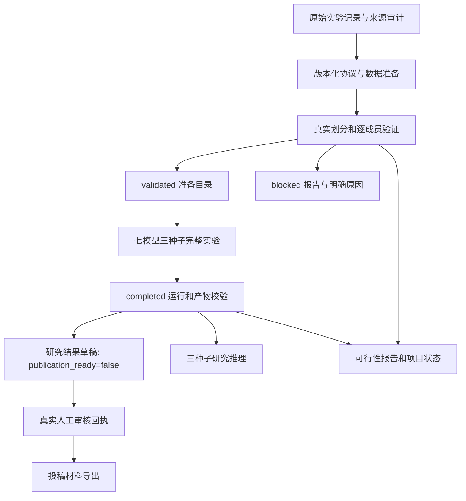

# SafeAMP-Dual Phase D — Gemini 开发实施计划

> **For agentic workers:** Implement the plan with the available tools and repository conventions. Steps use checkbox (`- [ ]`) syntax for tracking. 本文专门交给 Gemini 执行；以当前源码、真实证据和实际命令输出为准。

**Goal:** 修复数据证据、协议、数据准备、训练、推理与产物导出的衔接，形成可复现的正式实验路径；若真实证据或划分失败，交付可审计的阻断结果。

**Architecture:** 共用版本化协议与同一套准备/验证逻辑；可行性报告只汇总真实校验结果。训练完成、研究产物可用和投稿授权分别记录，未经证实的状态不得自动升级。

**Tech Stack:** Python 3.11、pandas、NumPy、scikit-learn、PyTorch、fair-esm、pytest；现有 React/Vite 与 FastAPI 仅做必要兼容检查。优先复用现有依赖。

**文档日期：** 2026-09-30（Asia/Shanghai；基线核查跨越 9 月 29 日晚至 30 日凌晨）。
**工作目录：** `D:/桌面文件/sci`。
**状态：** 开发交接规范；本文的新增接口、测试和命令标为目标契约，不表示已经实现或验证。

## Global Constraints

- 当前任务是实施交接。Gemini 接手后先检查工作区已有变更，再按任务依赖执行，不覆盖他人改动。
- CodeGraph 已存在：定位代码先查询图谱，再读取必要上下文；查询结果中若包含 `legacy/`，不得据此修改活动逻辑。
- 使用补丁、小范围修改；不新增依赖，不重构整个项目，不读取或输出 `.env`、密钥及个人身份资料。
- 当前目录此前没有 Git 仓库；重新检测后再决定本地提交，不执行 `git init`、reset、远程推送或部署。
- 序列域保持 10–50 个标准残基、线性未修饰单体。未知/冲突/不兼容测量保持缺失，不得补成负类。
- 端点保持 E. coli MIC ≤32 / ≥128 μg/mL 与 human erythrocyte HC50 ≤100 / ≥250 μg/mL；中间范围保留未知。
- 正式模型集合固定为 `svm, rf, dual_gated, dual_concat, phys_only, esm_only, single_task`；种子固定为 `11, 23, 42`；开发五折、内部留出、外部队列均须存在。
- 不得因结果不理想而改变阈值、折数、随机种子、端点、外部角色或删掉导致失败的样本；科学设计变化必须单独记录并取得实际负责人的决定。
- 不把不同代表簇称为已经证实的全成员零同源泄漏；不得通过删除隔离检查来解除阻断。
- 新数据准备、训练与导出目录不可覆盖；历史结果保留。任何测试 fixture 或模拟模型不得进入正式证据目录。
- 不把测试通过等同于科研可行、预测有效、作者同意或可投稿。
- 本地修复、必要测试、审计和满足门禁后的实验构成本计划；远程部署、付费 API、外部消息、投稿均不在范围内。

---

## 1. 已核实基线与必须纠正的判断

上一轮检查的实际输出为 `144 passed in 13.39s`；这是当时的测试基线，不是本计划实施后的验收结果。CodeGraph 当时报告 98 files、1,313 nodes、2,580 edges、35 routes。

`04_paper/research_status.json` 仍为 `formal_results_available=false`、`publication_ready=false`。`03_experiments/runs/` 只发现历史 blocked run，尚无正式结果或正式论文图表。

| 已核实位置 | 事实 | 对实施的约束 |
|---|---|---|
| `README.md:35` | `--dataset` 传入源 `records.csv` | 训练入口实际需要 validated 的准备目录，不能照抄现有命令 |
| `02_code/experiment_runner.py:100` | `load_dataset()` 要求 `manifest.json`、`dataset.csv`、`records.csv` 及哈希 | 缺任何一项必须拒绝训练 |
| `02_code/data/sources/combined_v2/manifest.json` | 状态 `cohorts_built`，430 条=417 开发+13 外部 | 合并数据不等于已验证训练数据；不要改状态字符串冒充通过 |
| `02_code/research_data.py:218` | `prepare()` 仍使用传递连通分量与 min 分母 | 协议修订没有贯穿准备及重载验证 |
| `02_code/research_feasibility.py:30` | 门禁统计簇数、总体标签和外部相似度，未执行 `partition()` / `validate_partition()` | 现有 ready 报告不足以证明五折与留出真实可行 |
| `docs/amendments/PROTOCOL_AMENDMENT_01_CDHIT.md` | 代表聚类定义为 NW matches/min、长度比≥0.50；跨折声明是代表序列口径 | 不可把 `identity_mode=max` 默认为这份修订已批准的定义 |
| `02_code/publication_artifacts.py:9` | 正式导出还要求 publication_ready、formal_results_available、all_claims_verified | 训练完成不能自动赋值全部 true |

数字口径：`combined_v2` manifest 记开发集 60 簇；可行性报告记合并 430 条共 61 簇、最大簇 38。不要把 61 簇写成 417 条开发集的结果。

结论：当前可确认的是工程已有实现、存在一次较弱检查下的 ready 报告；真实的正式训练就绪状态须由以下任务重新判定。

## 2. 优先级与新增核查事实

| 优先级 | 发现与位置 | 必须达到的结果 |
|---|---|---|
| P0 | `02_code/test_cdhit_split.py:79` 手工列出 amp/hemo；`build_cohorts.py:68,112` / `external_curator.py:45,86` 将其写成 raw JSON、计算哈希并标 experimental | 哈希只能证明文件未变，不能证明标签来自原始实验；必须重建逐条 assay 证据链 |
| P0 | `research_data.py:58` 仅 DBAASP 会重放提取，Benchmark_* 只通过字段/文件检查 | 来源改名、伪造原始 JSON 不得绕过标签重推导 |
| P0 | `build_cohorts.py:61` 提取的开发 PMID/DOI 没有用于外部过滤；外部 13 条共用默认 DOI | 做真实 accession/原始论文/测量独立性核查，缺证据明确列为 unresolved |
| P0 | `research_feasibility.py:161` 长度条件为 a/b<0.5 AND b/a<0.5，正长度时永不成立 | 使用对称长度比；只在协议要求的比较阶段应用，不得顺便跳过全部隔离检查 |
| P1 | `cdhit_cluster.py:70` 反向元组排序使同长字典序降序，与修订案升序矛盾 | 排序固定为 `(-len(seq), seq)`，输入重排不能改变序列到簇的归属 |
| P1 | `experiment_runner.py:125,187` 没有完成 formal_results_available 状态迁移 | 真实完整产物通过校验后才能置 true，投稿状态保持 false |
| P1 | `publication_artifacts.py:13,79` 草稿生成入口提前要求投稿授权，输出又标未授权 | 明确研究草稿导出与最终投稿导出两种入口，保留严格投稿门禁 |
| P1 | `research_readiness.py:10` 只能渲染 blocked pilot | 建立从当前准备/运行产物生成状态的入口，避免状态靠手改 |
| P2 | `05_web_server/research_api.py:99` 混合 liveness/readiness；metrics 每次新建缓存 | 本轮只修正状态语义和必要模型加载验证；缓存性能改造另列后续任务 |

证据边界：没有核实这些外部肽在现实中是否存在适合的实验；已核实的是当前代码没有提供足以重建所述端点的原始测量。不得把这句话改写成已证明数据造假，也不得继续宣称外部实验依据已全部验证。

## 3. 目标链路与文件责任



| 文件 | 操作 | 责任 |
|---|---|---|
| `02_code/evidence_validation.py` | 新增 | 来源登记、原始测量和标签重推导校验 |
| `02_code/research_protocol_config.py` | 新增 | 协议不可变配置、版本哈希、允许配置校验，不依赖训练/网页模块 |
| `02_code/external_curator.py`、`02_code/build_cohorts.py` | 修改 | 消除手写标签正式入口，消费可追溯 external 输入，写逐条排除原因 |
| `02_code/cdhit_cluster.py` | 修改 | 确定性排序和参数校验；如实描述自定义 NW 代表聚类 |
| `02_code/research_data.py` | 修改 | 共用预处理、协议分发、prepare、partition、validate_partition |
| `02_code/research_feasibility.py` | 修改 | 复用准备引擎，依据实际检查生成报告 |
| `02_code/experiment_runner.py`、`02_code/inference_runtime.py` | 修改 | 协议感知重载、状态迁移、产物完整性、推理一致性 |
| `02_code/run_artifacts.py` | 新增 | 共享已完成运行校验，供研究导出、推理、状态生成调用 |
| `02_code/publication_artifacts.py` | 修改 | research 模式与有证据绑定的 publication 模式 |
| `02_code/research_readiness.py` | 修改 | 当前状态生成入口，保留旧 blocked renderer 的明确用途 |
| `05_web_server/research_api.py` | 小范围修改 | readiness 语义，不把 liveness 200 当模型可用 |
| `02_code/tests/` | 新增或扩展 | 本文测试矩阵，软件夹具只落在 pytest tmp_path |
| `README.md`、`docs/REMEDIATION_STATUS.md`、`docs/DELIVERABLES_SUMMARY.md`、`docs/handoff/TASK_STATE.md`、`docs/DOCUMENTATION_INDEX.md` | 修改 | 当前状态一致，历史里程碑保留并标为历史 |
| `04_paper/research_status.json` | 由程序生成 | 对应当前数据/运行哈希，不得凭文字报告手改布尔值 |

`legacy/`、历史 run、`retired_unsupported/` 与既有 raw 数据只读。`test_cdhit_split.py` 的历史常量可保留作旧示例，但必须断开正式数据导入链并标注非实验证据。

## 4. 数据与状态契约

### 4.1 协议配置贯穿全链路

新增 `research_protocol_config.py` 提供 `get_protocol(protocol_id: str) -> ProtocolSpec` 和 `protocol_digest(spec: ProtocolSpec) -> str`。未知 ID、缺字段、矛盾组合或未冻结配置均明确拒绝。配置至少包含：

```python
from dataclasses import dataclass
from typing import Literal

@dataclass(frozen=True)
class ProtocolSpec:
    protocol_id: str
    protocol_version: int
    clustering_method: Literal['transitive', 'greedy_nw']
    membership_identity: Literal['min', 'max']
    min_length_ratio: float
    cross_identity: Literal['min', 'max']
    cross_scope: Literal['all_members', 'members_to_representatives']
    cutoff: float = 0.40
    folds: int = 5
    partition_seed: int = 42
    alignment: str = 'global_nw_match2_mismatch-1_gap-2_canonical_diagonal_first'
```

digest 使用 dataclasses.asdict(spec) 的 UTF-8、排序键、固定分隔符 JSON。配置、协议正文哈希、修订案哈希写入 prepared manifest；run 保存完整快照。不兼容变化必须新建版本。

1. `legacy-v1` 固定version=1、clustering_method=transitive、membership_identity=min、min_length_ratio=0.0（不筛长度）、cross_identity=min、cross_scope=all_members、cutoff=0.40、folds=5、partition_seed=42；旧调用不能悄悄改变。
2. `protocol-amd-01` 的代表聚类部分按现有修订案实现并测试；其跨集合定义与 max 分母、代表独立性声明的冲突记录为 `protocol_conflict`。冲突未明确解决前不用于正式放行。
3. 工程默认保留逐成员检查。改为仅代表比较、改分母或引入长度跳过属于科学协议决定，不得为通过 430 条数据自行选择。
4. Gemini 继续完成不依赖科学决定的修复与失败路径测试，集中交付需决定的精确字段，不把整个开发停在一句需要确认。
5. 当前是 Python 自定义 NW 贪心实现。没有独立等价验证时，称 CD-HIT-inspired / 自定义 NW 代表聚类，不声称运行官方 CD-HIT。

### 4.2 准备目录

成功同时包含 `manifest.json`、`records.csv`、`dataset.csv`、`cluster_membership.csv`、`partition_audit.json`、`evidence_audit.json`、`exclusions.json`。manifest schema_version=2，保存协议、来源输入哈希、导出 records/dataset/审计文件哈希和代码版本哈希。输入 records 与重新序列化输出 records 的哈希分别记录，不混用。

dataset 延续现有列；source_role 不变。development 的 fold 为整数0–4，test/external 的 fold=-1。cluster_membership 保存 sample_id、cluster_id、representative_sample_id，ID 可回溯到数据。

partition_audit 必含各 split 的样本数、簇数、amp/hemo 阳性/阴性/缺失数；每个 fold 的 train/validation 同样统计。记录跨集合检查定义、比较对数、违规对和状态。若协议只有代表隔离，不能称全成员隔离或独立正交。

失败写 blocked manifest 和结构化 blockers，不留下 loader 能识别为 validated 的半成品。未知异常不得留下 completed。既有目录在任何写入前拒绝，不能先覆盖再报错。

### 4.3 四种状态不可合并

| 轴 | 允许状态 | 升级依据 |
|---|---|---|
| 准备 | blocked / validated | 证据、协议、实际划分及完整性全部通过 |
| 运行 | running / blocked / failed / completed | 全部模型、种子、预测、checkpoint、指标通过校验 |
| 结果 | formal_results_available=false / true | completed 的真实正式运行与完整产物 |
| 投稿 | publication_ready=false / true | 绑定当前稿件、运行、结果、引用、声明的实际审核 |

feasibility 的 ready 只能表示它验证了上述 prepared 目录，附 manifest 路径与 SHA256，不能代替 prepared.status。训练结束应为 completed + formal_results_available=true + publication_ready=false。研究草稿同样未获投稿授权。最终审核使用独立回执，不能回写不可变训练清单取得授权。

## 5. 顺序实施任务

### Task 0：固定可复核基线与变更范围

**文件：** 新建 `docs/handoff/PHASE_D_IMPLEMENTATION_LOG.md`；基线证据写新版本 `output/verification/phase_d_baseline_*`，不覆盖既有日志。
**输入/输出：** 消费当前工作区；产出实际命令、退出码、文件哈希和已有改动/非 Git 状态说明。

- [ ] 检查工作区及相关子目录 AGENTS.md，记录用户已有改动。
- [ ] 用下列 CodeGraph 查询活动符号，排除 legacy 结果。
- [ ] 保存基线测试实际输出及退出码；失败先定位，不删除失败测试。
- [ ] 分别记录 source cohort、prepared、run 的状态，不启动训练。

```powershell
Set-Location 'D:/桌面文件/sci'
codegraph status
codegraph explore '02_code/research_data.py prepare partition validate_partition'
codegraph explore '02_code/experiment_runner.py load_dataset run'
codegraph explore '02_code/publication_artifacts.py load_predictions export'
python -B -m pytest -q -p no:cacheprovider
```

**验收：** 日志记录真实数量，不硬编码必须144；定位输入路径和协议缺口。只有确有 Git 且获授权时按任务本地提交，否则保留补丁/文件哈希，不初始化仓库。

### Task 1：恢复外部标签实测证据链（P0）

**修改：** `build_cohorts.py`、`external_curator.py`、`research_data.py::validate_records`。
**新增：** `evidence_validation.py`、`tests/test_external_evidence.py`；复用 `assay_records.py` 和已有来源适配器。
**接口：** `validate_source_evidence(records: pd.DataFrame) -> dict`；成功返回逐记录、逐端点重推导结果和来源哈希，已声明标签无证据支持则抛 `ResearchDataError`，由调用方保存 evidence_audit/blockers。

对预期证据缺失先汇总逐记录问题，再抛异常；异常的 `evidence_audit` 属性携带完整结构化结果，prepare/feasibility负责持久化。不能只报第一条错误而丢失其余未核实来源。既有ResearchDataError调用保持兼容。

- [ ] 先加入下表失败用例，确认当前二元标签包装不能满足新证据契约。
- [ ] 断开 `CURATED_DATABASE_ENTRIES` 的正式 external 导入，构建器新增必需的 `--external` 输入。未提供输入时明确报缺少来源，不启用手写默认值。
- [ ] 每个观测关联 accession、真实 snapshot/哈希、原始实验论文定位、菌/细胞、metric、value、unit、修饰和实验条件，用测量层重推导标签。
- [ ] 缺单端点保留 unknown；全端点未知则按原规则排除并留原因。已有标签与证据冲突时拒绝，不静默改值。
- [ ] 按规范来源登记/适配器验证；仅修改 source_dataset 不能绕过重推导。
- [ ] 核查跨队列原始论文与测量复用，规范化 DOI/PMID。数据库介绍论文与原始实验论文分开记录，不能仅因共同引用数据库介绍文献排除，也不能靠数据库名称不同判独立。
- [ ] 停止默认 DOI 填充。现有13条无可核实测量时标 unresolved，不以保住13条为目标。combined_v2 保留，新结果写新版本目录。
- [ ] 收紧原有 HC50 适配器中不符合冻结端点的别名；例如不能仅因 MHC 被现函数接受，就视为 human HC50。

| 失败夹具 | 验收断言 |
|---|---|
| 手写 amp/hemo+有效 JSON 哈希，无 assay | 拒绝实验资格 |
| raw 哈希正确但 CSV 标签改变 | 重推导拒绝 |
| 来源改名为 Benchmark 前缀 | 不绕过校验 |
| 无抗菌注释/蛋白片段身份被赋0/0 | unresolved 或排除 |
| 非人红细胞/百分比非HC50/未知单位 | 对应端点未知，原因明确 |
| MIC 16–64、HC50中间区间或冲突测量 | 不产生确定标签 |

```powershell
python -B -m pytest 02_code/tests/test_external_evidence.py 02_code/tests/test_source_imports.py 02_code/tests/test_assay_records.py 02_code/tests/test_research_data.py -q -p no:cacheprovider
```

**验收：** 每个正式观测标签可从原始测量重推导。资料不足时逐条列缺项，继续独立软件任务，真实训练 blocked；不得伪造 assay 让正式队列通过。

### Task 2：统一协议和确定性相似度实现（P0/P1）

**修改：** `research_data.py::sequence_identity/assert_cross_isolation`、`cdhit_cluster.py`、cohort/feasibility 调用方。
**新增：** `research_protocol_config.py`、`tests/test_protocol_contract.py`；扩展 `test_cdhit_cluster.py`。
**接口：** `sequence_identity(a,b)` 仍为min，新增关键词 `identity_mode='min'|'max'`；`assert_cross_isolation(left,right,cutoff=.40,*,protocol=None)`，None保持旧语义。同一 profile 各入口必须同义。

- [ ] 固定4.1的协议字段与digest，先保证legacy兼容和候选冲突显式阻断，不藏进默认参数。
- [ ] NW的整数matches直接除以选定分母，不在各文件重复 round(identity×min)/max 转换。
- [ ] 长度比共用 `min(len(a),len(b))/max(len(a),len(b))`，空序列报错；聚类筛选和跨集检查分别遵循协议。
- [ ] 排序使用 `sorted(sequences, key=lambda s: (-len(s), s))`，结果映射回原输入顺序。
- [ ] 修复 cdhit_ratio 的不可能AND条件并调用共用函数；旧CLI若保留，必须检查其与profile一致，不能覆盖冻结规则。
- [ ] 加入真正A–B–C非传递链与成员跨簇反例。贪心分组不能代替全成员隔离，不删除反例测试。
- [ ] 修改已证实错误的代码描述；科学宣称待核实，不代签科学批准。

以下是目标接口的完整回归样例，可放入 `test_protocol_contract.py`；纯序列夹具只用于软件测试：

```python
import pytest
from research_data import sequence_identity
from cdhit_cluster import cdhit_cluster_sequences

def test_identity_modes_have_distinct_meaning():
    short, long = 'A' * 10, 'A' * 25
    assert sequence_identity(short, long) == pytest.approx(1.0)
    assert sequence_identity(short, long, identity_mode='max') == pytest.approx(0.4)
    assert sequence_identity(long, short, identity_mode='max') == pytest.approx(0.4)

def test_equal_length_representatives_use_ascending_sequence_order():
    sequences = ['W' * 10, 'C' * 10, 'A' * 10]
    _, representatives, _ = cdhit_cluster_sequences(sequences, cutoff=0.4)
    assert representatives == ['A' * 10, 'C' * 10, 'W' * 10]
```

还须验证 cutoff恰好0.40为违规、长度比小于/等于/大于0.50、参数交换、输入重排；旧manifest只允许明确识别的legacy规则，不能猜成新规则。

```powershell
python -B -m pytest 02_code/tests/test_protocol_contract.py 02_code/tests/test_cdhit_cluster.py 02_code/tests/test_research_data.py 02_code/tests/test_isolation_diagnostics.py -q -p no:cacheprovider
```

**验收：** 同profile全链路同语义，min/max差异有测试；protocol-amd-01冲突未解决时报告protocol_conflict，其余实现继续。

### Task 3：共用准备引擎与真实可行性判断（P0）

**修改：** `research_data.py::prepare/partition/validate_partition/main`、`research_feasibility.py`；兼容 `dataset_manager.py`。
**新增/扩展测试：** `tests/test_preparation_pipeline.py`、`test_feasibility_gates.py`。
**接口：** `prepare_frame(records,protocol) -> (dataset,audit)` 做合并、聚类、确定性划分及验证，不写文件、不提取ESM、不训练；`prepare(records_path,output_dir,cutoff=.40,*,protocol_id='legacy-v1')` 调用它并持久化4.2契约。cutoff与profile矛盾则报错。

- [ ] 准备与feasibility共用prepare_frame，不保留两套近似判断。
- [ ] 保留固定seed42、development的6-way outer首个留出与剩余五折方案。不搜索seed直到成功，不用外部标签安排开发折。
- [ ] 逐任务验证每个train/validation/test/external双类；development簇数不含external。
- [ ] 实际检查协议规定的所有跨集合关系，保留违规证据与定义。
- [ ] 新增 `audit_prepared_feasibility(prepared_dir, output_dir) -> tuple[bool, dict]` 验证prepared文件并重放科学校验；旧 `audit_feasibility` 的records路径使用同引擎，不能因读到validated字样直接通过。
- [ ] prepare CLI新增 `--protocol-id`；feasibility新增 `--prepared`，与 `--records` 二选一。准备协议与请求不一致则拒绝。
- [ ] 失败保存blockers、可得的标签统计及诊断，未执行检查不能标passed。

| 必须覆盖场景 | 预期 |
|---|---|
| 合并簇≥6而development不足6 | blocked，不用external补开发簇 |
| 总体双类但某validation Hemo单类 | blocked，列fold/任务/计数 |
| 只有external提供AMP阴性 | blocked，开发集不合格 |
| 不同cluster_id成员跨集合超过阈值 | blocked，列sample对 |
| 证据通过但全体坍缩一簇 | blocked，无强行拆簇 |
| 相同数据/协议重复写入不同新目录 | 相同归属与划分，生成时间可不同 |
| 目录已存在或中途异常 | 不覆盖，无validated半成品 |
| 明确标记的合法pytest fixture | prepared可被loader重载，不能进入正式目录 |

```powershell
python -B -m pytest 02_code/tests/test_preparation_pipeline.py 02_code/tests/test_feasibility_gates.py 02_code/tests/test_research_data.py -q -p no:cacheprovider
```

**验收：** feasibility与prepare同输入/协议同科学结论；失败定位到证据/样本/折；成功不存在报告ready而loader不接受的断点。

### Task 4：训练清单生命周期与完整产物校验（P1）

**修改：** `experiment_runner.py`、`inference_runtime.py`。
**新增：** `run_artifacts.py`、`tests/test_run_lifecycle.py`；扩展 `test_experiment_runner.py`、`test_runtime_api.py`。
**接口：** `load_dataset(folder)` 保持返回(data,manifest)，按manifest协议重放；`validate_run_artifacts(run_dir: Path) -> dict` 校验completed运行的必需产物和元数据，不批准投稿。

避免状态循环：另设内部 `validate_artifact_payloads(run_dir, manifest) -> dict`，只验证产物及其元数据，供runner在最终写completed前调用；公开 `validate_run_artifacts` 必须先要求completed再复用它。不能为完成检查而提前暴露completed。

- [ ] 将输入、软件版本采集及ESM前置失败纳入异常路径；目录一旦创建就有可解释manifest，失败显式formal_results_available=false。
- [ ] loader明确拒绝CSV路径和cohorts_built，提示需要prepared目录，不自动直接训练源CSV。
- [ ] 保留7模型/3种子、五折OOF、训练折scaler、开发集校准阈值、全开发重训；固定CONFIG，不增加搜索。
- [ ] completed前校验21个joblib、3个gated checkpoint、特征、逐样本预测、集成指标、CI/比较及全部对应哈希；不只看文件存在。
- [ ] N样本的predictions行数为N×7×3×2，每个sample/model/seed/task恰好一条；未观测端点可有预测，y_true保持缺失。
- [ ] 成功最终写completed、formal_results_available=true、publication_ready=false；异常保留失败原因和partial产物，不计正式结果。
- [ ] 本轮不支持partial接续正式run；重跑新目录，恢复功能另订契约。
- [ ] runtime支持新manifest，保留三种子/特征/权重/代码哈希校验；不把作者投稿审批变成研究推理启动条件。

**必测：** 初始化异常、缺模型/种子/样本、重复预测、标签/分区/折被改、概率NaN或越界、错误ESM、checkpoint/scaler/calibration篡改、准备目录哈希变化、失败run无法导出或推理。

生命周期测试用tmp_path和显式软件stub，不下载模型、不写正式目录；真实模型验收仅在Task 7科学门禁全过后执行。

```powershell
python -B -m pytest 02_code/tests/test_run_lifecycle.py 02_code/tests/test_experiment_runner.py 02_code/tests/test_runtime_api.py 02_code/tests/test_model_contracts.py 02_code/tests/test_evaluation.py -q -p no:cacheprovider
```

**验收：** completed对应完整产物契约。软件测试通过不能把当前项目formal_results_available单独置true。

### Task 5：研究草稿与投稿导出闭环（P1）

**修改：** `publication_artifacts.py`；复用 `run_artifacts.py`。
**测试：** 扩展 `test_publication_artifacts.py`，新增 `tests/test_publication_approval.py`。
**接口：** `export(run_dir,output_dir,resamples=2000,*,mode='publication',approval_path=None)`；CLI新增 `--mode research|publication`、`--approval`，默认publication，不能省略参数绕过旧门禁。

- [ ] 新增 `load_research_predictions(run_dir)`，复用数据/运行/预测完整性检查，要求研究完成，不要求人工投稿批准。
- [ ] 保留 `load_predictions()` 严格默认职责；新schema投稿授权读取明确approval_path，不向父目录搜任意reference_audit再信一个true。旧schema缺有效证据绑定也不允许最终投稿。
- [ ] research生成现有性能表、校准、CI/对比、图形；manifest写artifact_scope=research_draft、publication_ready=false、review_status=pending，保留OOF selection-only说明。
- [ ] 独立审核回执绑定run manifest、数据/协议、研究产物manifest、manuscript.tex、references.bib、claims.csv、reference_audit.json、declarations.json的实际SHA256。
- [ ] 回执含真实reviewed_at、可追责审核者、逐项结论及批准范围。缺失、待审、内容变化或哈希错误均拒绝；不生成假的reviewer/author/funding。
- [ ] 不回写immutable训练清单；最终导出记录approval哈希、parent研究产物哈希与输出文件哈希。批准仅适用当前明确稿件/图表，内容改变后失效。
- [ ] DOI元数据匹配不自动all_claims_verified；实际论点对应原文、声明、复用许可仍需证据。
- [ ] 导出异常保持failed/generating，不宣告generated。图表只从冻结预测重算，不使用retired_unsupported。

**完整路径测试：** completed fixture → research成功但未批准投稿 → 无回执publication拒绝 → 明确合法的测试回执通过 → 更改稿件/引用/结果任一字节后拒绝。所有审核fixture标test_only且隔离在tmp_path，不能作为正式批准。

```powershell
python -B -m pytest 02_code/tests/test_publication_artifacts.py 02_code/tests/test_publication_approval.py -q -p no:cacheprovider
```

**验收：** 真实研究结果可供人工审阅；没有实际批准的最终投稿仍阻断。

### Task 6：状态文档与API事实一致（P1/P2）

**修改：** `research_readiness.py`、`research_api.py`及第3节状态文档。
**测试：** 新增 `tests/test_research_status.py`，扩展 `test_health_and_metrics.py`、`test_runtime_api.py`。
**接口：** `generate_current_status(prepared_dir,run_dir=None) -> dict`；新增CLI `--prepared DIR --run DIR --output FILE`，run可省略。旧generate(source,prepared)明确为历史blocked renderer，不拿它自动重写当前稿件。

- [ ] 根据实际prepared/run校验推导状态，记录路径、哈希、时间和blockers；没有formal run时formal_results_available=false。
- [ ] TASK_STATE顶部只写当前摘要，101/132/137/144等旧测试数和blocked/ready里程碑保留带日期历史段，不能机械全替换。
- [ ] 统一开发60/合并61的历史口径；新数据重算新数，不把历史数当通过目标。
- [ ] README使用source→prepared→audit→run→research artifacts的实测命令；注明不可覆盖目录和真实数据缺项。
- [ ] `/api/health`定义进程存活；新增`/api/ready`，实际模型可用200、未配置或损坏503，原因与system_status一致。
- [ ] 缓存未接真实推理时metrics标unavailable/not_integrated，不能每请求新建缓存后宣称是真实命中率。缓存接入和性能优化另列后续，不扩本轮范围。
- [ ] 仅修改前端或验收模型交互时运行frontend build/lint和真实浏览器，不无关改版。

```powershell
python -B -m pytest 02_code/tests/test_research_status.py 02_code/tests/test_health_and_metrics.py 02_code/tests/test_runtime_api.py -q -p no:cacheprovider
```

**验收：** 进程存活、模型就绪、实验完成、投稿批准在页面/API/文档中互不替代。

### Task 7：集成验收及有条件的真实实验

**输入：** Task1–6实现、冻结协议、可重推导真实来源。
**输出：** 新prepared/run/research artifacts，或可审计blocked报告。软件修复完成与科学门禁未通过可同时成立，必须分别报告。

- [ ] 全量pytest保存文本/XML和退出码；检查CLI help已实现本文参数。
- [ ] 从新来源版本生成prepared，仅status=validated继续。
- [ ] 对同一prepared做feasibility复核，记录manifest哈希，未执行检查不能冒充passed。
- [ ] 确认真实ESM checkpoint可用且哈希正确，缺失按实际依赖处理，禁止fallback。
- [ ] 在真实训练前冻结本轮源码、协议和配置并保存哈希。训练后若改特征/模型/数据规则，不能手改哈希让旧run通过，须新run；纯状态文档更新不重写训练清单。
- [ ] 新run执行全部7×3配置：105次折配置拟合、21次最终配置拟合。single_task一次配置含两个网络，不能误称底层网络总训练次数。
- [ ] 验证全产物后生成研究草稿，不按预设AUC/AUPRC挑run，不以效果优异作为工程验收。
- [ ] loopback本地加载run，单条/批量预测与离线同模型对照，未配置503、非法输入422、ready状态一致。
- [ ] 真实图表生成使用scientific-visualization技能；若处理LaTeX/PDF则使用相应编译/渲染流程。读到实际输出并核对源数据后报告通过。
- [ ] 执行codegraph sync/status，不存在索引时不擅自初始化。

**硬门禁：** 缺原始assay、protocol_conflict、单类折、跨集违规、真实ESM缺失、产物校验失败任一出现，停止对应后续实验/导出，继续独立的软件修复、测试及交接。不得为绿色报告修改科学标准。

## 6. 目标运行手册（CLI完成后执行）

这些是开发完成后的命令契约，当前源码尚不全部支持。版本目录若已存在须另取后缀，不删历史目录重跑。

```powershell
Set-Location 'D:/桌面文件/sci'
$phaseDStamp = Get-Date -Format 'yyyyMMdd-HHmmss'
$phaseDPrepared = ('03_experiments/prepared/phase_d_{0}' -f $phaseDStamp)
$phaseDAudit = ('output/verification/phase_d_{0}' -f $phaseDStamp)
$phaseDRun = ('03_experiments/runs/phase_d_{0}' -f $phaseDStamp)
$phaseDArtifacts = ('04_paper/generated/phase_d_{0}' -f $phaseDStamp)

# cohorts_built不是validated。
Get-Content '02_code/data/sources/combined_v2/manifest.json'

# 旧数据仍须重推导；协议冲突未解决时应拒绝并保存原因。
python -B 02_code/research_data.py --records 02_code/data/sources/combined_v2/records.csv --output $phaseDPrepared --protocol-id protocol-amd-01
if ($LASTEXITCODE -ne 0) { throw '准备未通过，检查evidence/protocol/partition报告。' }

python -B 02_code/research_feasibility.py --prepared $phaseDPrepared --output $phaseDAudit
if ($LASTEXITCODE -ne 0) { throw '可行性复核失败，停止真实实验。' }

# --dataset传准备目录，不能传records.csv。
python -B 02_code/train_and_eval.py --dataset $phaseDPrepared --output $phaseDRun
if ($LASTEXITCODE -ne 0) { throw '实验未完成，不导出成功结果。' }

python -B 02_code/publication_artifacts.py --run $phaseDRun --output $phaseDArtifacts --mode research
if ($LASTEXITCODE -ne 0) { throw '研究产物导出失败。' }

python -B 02_code/research_readiness.py --prepared $phaseDPrepared --run $phaseDRun --output 04_paper/research_status.json
if ($LASTEXITCODE -ne 0) { throw '研究状态生成失败。' }
```

Task1形成新正式源版本后，把第2步输入改为该版本真实records.csv，在日志记录来源/哈希，不能继续用未核实combined_v2标签。最终publication命令仅在真实回执存在后记录执行，不提供伪回执模板或自动置真命令。

本地推理仅在进程会话设置SAFEAMP_RUN_DIR为新run，使用 `python -m uvicorn app:app --app-dir 05_web_server --host 127.0.0.1 --port 8000`。模型不存在时验收503与提示，不宣称已验证真实预测。外部LLM报告、云端压测不是本计划验收必需项。

## 7. 完成定义与交付格式

| 编号 | 证据 | 成功条件 |
|---|---|---|
| A1 | evidence_audit、排除原因、原始snapshot哈希 | 正式观测可重推导，无证据不训练 |
| A2 | 协议配置/正文哈希与入口测试 | 同profile全链路一致，科学冲突不放行 |
| A3 | partition_audit、loader重载 | 各折双类、来源和跨集规则实际通过 |
| A4 | 实际pytest文本/XML与退出码 | 新旧契约通过，无忽略或篡改失败 |
| A5 | completed manifest和产物哈希 | 21配置、3 checkpoint、全样本预测，非partial/stub |
| A6 | research清单与渲染复核 | 表图来自冻结预测，publication_ready=false |
| A7 | 可选真实回执与最终导出 | 实际人工批准且哈希绑定一致才true |
| A8 | 状态文档、API检查、CodeGraph status | 已完成/未完成/阻断表述一致 |

A1–A4是启动前必要验收。A5–A6仅真实门禁满足后完成，否则标blocked并附定位证据。A7由实际作者审查，不由编码代理自批。不得声称全部完成而隐去未运行实验。

### 7.1 实施范围与变更控制

Task0–4是数据与训练的核心交付，Task5–6是研究产物和状态衔接，Task7消费这些结果。独立测试可并行，协议与数据契约未固定前不并行改同一公共接口。只做与上述缺口相关的改动；性能优化、新模型、新UI及云端运维另列后续。

若改为代表簇隔离，除了折划分，还必须重新审查簇Bootstrap/配对检验的重采样单位和依赖假设；不得把贪心簇直接描述为统计独立单元。该科学决定未解决时，CI文件的生成能力不代表对应推断已有效。

Gemini最终提交 `docs/handoff/PHASE_D_IMPLEMENTATION_LOG.md`，包含：

1. 修改文件及原因、保留的旧行为与兼容方式。
2. 实际命令、退出码、结果及日志；未执行项及原因。
3. 数据/协议/prepared/run/artifacts路径及SHA256，无密钥。
4. 状态四轴取值，不把报告文字当实际批准。
5. 未解决外部证据、协议冲突、真实实验是否执行。
6. 有结果则提供可追溯指标和局限；blocked则列缺少的具体资料或决定。

每完成独立任务更新对应checkbox与实施日志。计划已写好、接口存在或旧报告称通过，均不能代替实现与实际验收。
