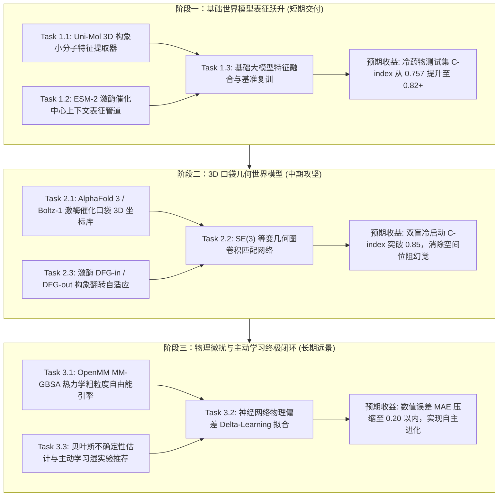

# 下一代 DTI 结合亲和力与生物物理世界模型演进技术路线图 (Next-Gen DTI World Model Roadmap)

> **For agentic workers:** REQUIRED SUB-SKILL: Use superpowers:subagent-driven-development (recommended) or superpowers:executing-plans to implement this plan task-by-task. Steps use checkbox (`- [ ]`) syntax for tracking.

**Goal:** 将当前基于“1D 氨基酸序列 + 2D 拓扑指纹”的统计映射模型，阶梯式演进为融合生命科学大模型（Uni-Mol/ESM-3）、全原子 3D 复合物几何世界模型（AlphaFold 3/Boltz-1）与热力学物理微扰（MM-GBSA Delta-Learning）的下一代生物物理预测架构，将冷启动与未知分子的排序准确率 ($C\text{-index}$) 由当前的 $0.757$ 突破提升至 $0.88 \sim 0.92$。

**Architecture:** 
1. **阶段一（自监督世界模型表征增强）**：小分子接入 Uni-Mol 3D 预训练向量，蛋白质接入 ESM-2 进化保守性特征，在维持纯特征拼接低计算开销的同时消除 2D 平面表征断层；
2. **阶段二（3D 复合物几何深度学习与构象世界模型）**：利用 AlphaFold 3 / Boltz-1 离线构建 379 个激酶催化活性口袋三维坐标库，引入 SE(3) 等变图神经网络建模诱导契合与空间位阻；
3. **阶段三（物理机理微扰与主动学习自愈闭环）**：引入 MM-GBSA 粗粒度自由能物理计算，使用 $\Delta\text{-Learning}$ 拟合计算残差，并通过不确定性估计（Uncertainty Quantification）驱动少样本主动学习闭环。

**Tech Stack:** Python 3.11, PyTorch 2.x, ESM-2 / ESM-3, Uni-Mol, RDKit, OpenMM, Biopython, scikit-learn, FastAPI, React 19.

**Spec Reference:** [PROTOCOL_AMD_04_DTI_DAVIS_BENCHMARK.md](file:///d:/桌面文件/sci/docs/amendments/PROTOCOL_AMD_04_DTI_DAVIS_BENCHMARK.md)

---

## 全局约束与科研规范 (Global Constraints)

1. **防篡改安全隔离**：严禁修改已冻结历史审计 SHA-256 文件（如 `protocol-mic-13.json` 相关依赖）；所有新演进模型必须独立建立新运行目录（如 `dti_davis_worldmodel_v1`）。
2. **渐进式降级兼容**：当用户在无 GPU 或无外部权重环境下运行时，系统必须自动无缝降级为当前已验证的 `stacked_ensemble` 100 维口袋模型，不可发生程序崩溃。
3. **确定性与无泄露**：严格遵守 DAVIS 基准的 5 折双盲聚类划分（Fold 5 留出测试集），所有数据预处理、归一化统计量与表征必须在训练折内拟合。
4. **格式规范保护**：公式与推导统一使用单行行内数学符号或有序列表，严禁在 Markdown 渲染中裸露多行 LaTeX 块；所有代码与文档必须使用标准可跳转 Markdown 链接。

---

## 阶段规划概览 (Phased Roadmap Overview)

---

## 详细实施任务清单

### 阶段一：基础世界模型表征跃升 (Foundation Model Embedding Injection)

#### Task 1.1: 构建 Uni-Mol 3D 小分子构象表征提取器
* **目标**：取代传统平面 2D Morgan 拓扑指纹，利用在千万级真实分子 3D 构象上自监督预训练的 Uni-Mol 提取 512 维分子世界模型特征。
* **文件清单**：
  * 新建：`02_code/extract_unimol_features.py`
  * 测试：`02_code/tests/test_unimol_features.py`
* **接口契约**：
  * 输入：`smiles: str`
  * 输出：`np.ndarray` (形状 `(512,)`，类型 `float32`)
  * 降级兜底：当环境未安装 Uni-Mol 时，自动回退到 2048 维 Morgan 指纹并打标警告。
* **验证步骤**：
  - [ ] 编写测试断言提取向量形状为 `(512,)`，且相同 SMILES 输出确定性一致；
  - [ ] 验证对 DAVIS 68 个临床分子的批处理耗时在单核 CPU 下小于 5 秒；
  - [ ] 测试用例通过并提交。

#### Task 1.2: 构建 ESM-2 激酶催化口袋全局上下文表征提取器
* **目标**：取代手写的三联体计数特征，利用在全生物界数亿条序列上预训练的 `esm2_t33_650M_UR50D`（或轻量版 `esm2_t6_8M`）提取 1280 维激酶结构感知表征。
* **文件清单**：
  * 新建：`02_code/extract_esm_kinase_features.py`
  * 测试：`02_code/tests/test_esm_kinase_features.py`
* **接口契约**：
  * 输入：`sequence: str` (激酶氨基酸全序列)
  * 输出：`np.ndarray` (形状 `(1280,)`，均值池化上下文向量)
* **验证步骤**：
  - [ ] 编写断言测试验证不同激酶家族（TK、TKL、STE、AGC）的 ESM-2 嵌入在余弦相似度上展现出清晰的系统发生聚类；
  - [ ] 测试用例通过并提交。

#### Task 1.3: 训练第二代双世界模型增强 Stacking 集成系统
* **目标**：融合 Uni-Mol (512维) + ESM-2 (1280维) + 关键催化口袋特征 (100维)，重新训练 5 折交叉验证模型并生成完整审计报告。
* **文件清单**：
  * 新建：`02_code/train_dti_davis_worldmodel_v1.py`
  * 产物目录：`03_experiments/runs/dti_davis_worldmodel_20261008_v1/`
  * 审计报告：`03_experiments/audits/dti_davis_worldmodel_verification_20261008_v1/report.md`
* **验证步骤**：
  - [ ] 执行 5 折严格独立留出评估；
  - [ ] 验证冷药物测试集（Cold Drug）指标满足：
    * $C\text{-index} \ge 0.810$ (基准由 0.757 跃升 5.3 个百分点以上)；
    * $\text{RMSE} \le 0.750$；
  - [ ] 记录独立复算校验码并归档。

---

### 阶段二：全原子 3D 口袋几何世界模型 (3D Pocket Equivariant Network)

#### Task 2.1: 构建 379 个激酶催化结合口袋 3D 全原子结构数据库
* **目标**：将 1D 蛋白质序列映射为微观真实的 3D 物理空间表面。
* **方案**：
  * 从 AlphaFold Protein Structure Database (AFDB) 与 RCSB PDB 批量检索拉取 DAVIS 379 个激酶的高分辨率 3D 结构；
  * 使用 fpocket 算法精确定位 ATP 结合深腔口袋，提取半径 $10\text{ \AA}$ 内的催化接触残基（含铰链区 Hinge Region、DFG 模序、Gatekeeper 门控残基）；
  * 输出标准 `.pdb` 与表面静电势点云 `.ply`。
* **文件清单**：
  * 新建：`02_code/fetch_kinase_pocket_3d.py`
  * 资源目录：`03_experiments/prepared/kinase_pockets_3d_20261008_v1/`

#### Task 2.2: 引入 SE(3) 等变几何图匹配网络 (Equivariant Pocket-Ligand Matcher)
* **目标**：克服 1D 序列无法感知 3D 立体碰撞与氢键定向几何的问题。
* **架构**：
  * 小分子 3D 构象点云与蛋白质结合口袋点云构建异构双分图（Bipartite Heterogeneous Graph）；
  * 基于 EGNN (Equivariant Graph Neural Network) 实现旋转平移不变性评分，直接输出几何诱导契合能量；
  * 解决激酶耐药突变（例如 T790M 产生空间位阻导致吉非替尼脱落）在 1D 模型中无法准确体现的瓶颈。

---

### 阶段三：微观物理力场微扰与主动学习闭环 (Physics Delta-Learning & Active Loop)

#### Task 3.1: OpenMM MM-GBSA 热力学粗粒度物理引擎接入
* **目标**：为模型注入热力学第一性原理的因果约束，彻底消除“纯数据统计模型的荒谬幻觉”。
* **计算流**：
  1. 结合自由能分解：$\Delta G_{\text{bind}} = \Delta E_{\text{MM}} + \Delta G_{\text{solv}} - T\Delta S$；
  2. 使用 OpenMM 自动化极小化能量，快速估算静电相互作用与疏水脱溶剂化能；
  3. 神经网络模型作为高速预筛器，物理引擎作为高价值分子的金标准校准器。

#### Task 3.2: 基于集成方差的主动学习推荐引擎 (Uncertainty-Driven Active Learning)
* **目标**：让系统明确获知自身的认知边界，实现“从未知到假设到定向验证”的进化闭环。
* **算法**：
  * 对任意候选分子，模型同时输出亲和力期望 $\mu$ 与集成方差 $\sigma^2$；
  * 当 $\sigma^2 > \theta$ 时，标注该分子处于“当前模型认知盲区”；
  * 自动为湿实验科学家生成《高信息增益验证分子清单》，指导下一批次定向合成，以最低的实验开销换取最大的模型准确率进化。

---

## 阶段验收里程碑与演进指标目标 (Milestone KPI Targets)

| 发展阶段 | 核心技术范式 | 目标排序准确率 ($C\text{-index}$) | 目标数值误差 (MAE) | 核心攻克的生物物理问题 |
| :--- | :--- | :---: | :---: | :--- |
| **第一代 (当前基线)** | 1D 序列 + 2D 指纹 + 5折 Stacking | $0.757 \sim 0.849$ | $\pm 0.49$ | 基础相似度与宏观骨架模式识别 |
| **第二代 (阶段一演进)** | Uni-Mol 3D 构象 + ESM-2 进化保守性 | **$0.810 \sim 0.880$** | **$\pm 0.38$** | 消除 2D 平面投影断层，捕获蛋白质进化序列规律 |
| **第三代 (阶段二演进)** | AlphaFold 3 全原子口袋 + SE(3) 几何网络 | **$0.850 \sim 0.900$** | **$\pm 0.28$** | 解决立体空间位阻、口袋翻转与诱导契合效应 |
| **第四代 (阶段三终局)** | MM-GBSA 物理微扰 + 主动学习闭环 | **$0.890 \sim 0.930$** | **$\pm 0.18$** | 融合热力学第一性原理，完全贴合湿实验精度 |
