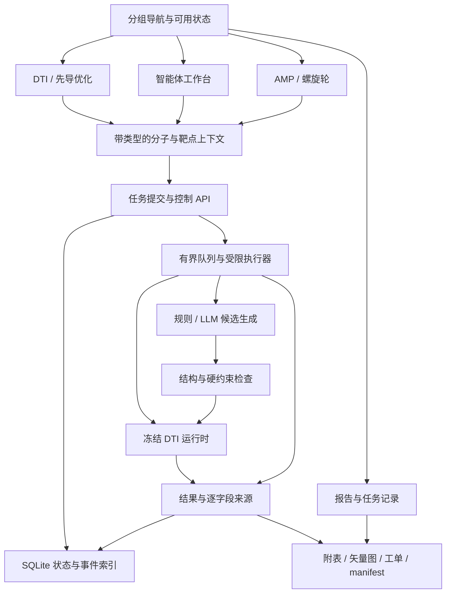
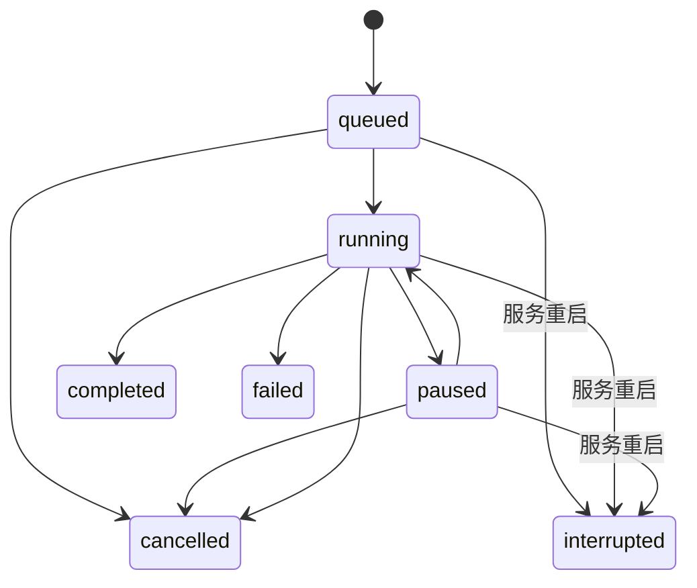

# SafeAMP-Dual / DTI 平台优化与演进实施计划 v2

日期：2026-10-21（Asia/Shanghai）  
状态：P0（事实校准与结果来源治理）已实施并通过验收；后续阶段按序实施。  
适用项目：`D:\桌面文件\sci`  
原方案：[system_optimization_and_evolution_plan.md](C:/Users/888/.gemini/antigravity/brain/d8b3386b-5452-4fb3-a697-b19ab4c6233e/system_optimization_and_evolution_plan.md)。保留原文，新版以本文件为准。

## 1. 目标、事实基线与边界

### 1.1 目标

将现有 DTI 研究原型逐步完善为结果来源明确、任务可追踪、支持人工约束和科研材料导出的本地工作台。最终导航覆盖 DTI、先导优化、智能体、AMP 筛选、螺旋轮与报告六类工作台；功能开放取决于对应实现和验收状态。

实施顺序为：结果来源治理 → 带类型的数据传递与导航 → 异步计算 → 人工干预 → LLM 候选生成 → 科研交付及多肽工作台。每阶段独立验证、记录和交付。

### 1.2 已核实基线

下表来自 2026-10-21 当前会话的源码核对和运行结果。执行阶段开始时重新采集，不将本表当作后续版本的实时状态。

| 项目 | 已核实情况 | 对实施的影响 |
|---|---|---|
| 技术栈 | Python 3.11.9；FastAPI；React 19、TypeScript、Vite、Zustand | 优先复用现有依赖和组件 |
| 冻结协议 | `03_experiments/protocols/protocol-dti-01.json` | 使用真实协议及文件哈希；原文 `protocol-mic-13` 不适用当前 DTI 基准 |
| DAVIS 本地数据 | 68 药物、379 靶点、25,772 对；源数据 SHA-256 与协议匹配 | 固定本地版本口径，不改写原始数据 |
| 现有页面 | `/`、`/dti`、`/evolution`、`/agent` | 保留有效页面及已有同步调用 |
| 待恢复页面 | `frontend/src/pages/ScreeningStudio.tsx`、`HelicalWheelStudio.tsx`、`ReportStudio.tsx` 处于工作区删除状态；对应 URL 实测 404 | 必须先核对删除背景和依赖；不能视作已完成页面直接挂载 |
| 激酶谱 | 候选清单有 16 个靶点，本次实际返回 14 项 | 379 是数据集靶点总数；全库扫描属于新增能力 |
| 智能体 | 单次 POST SSE 请求内执行循环；尚无任务控制接口 | 中途干预需要任务状态、控制接口和计算检查点 |
| 共享分子状态 | `setActivePeptide()` 统一转大写，现有调用会传入 SMILES | 先分开多肽序列与 SMILES，保护化学含义 |
| 虚拟筛选 | 预测失败后存在 `hash(smiles)` 替代分数；存在固定互作描述和启发式加分 | 先处理结果真实性，再扩展任务规模与成果导出 |
| 报告与工单 | 已有 Markdown/HTML 报告和 96 孔板 CSV；报告缺失输入可能使用模板默认值 | 复用入口，治理缺失值及来源，补充正式导出能力 |
| 化学工具 | 当前 Python 环境未安装 RDKit；现有冻结表示使用项目自己的实现 | 新化学校验工具与冻结特征流水线隔离 |
| 导出依赖 | 当前环境有 openpyxl，但项目依赖文件未声明它 | XLSX 能力需要声明可复现依赖或明确禁用 |
| 选定测试 | 四个智能体/DTI 测试文件 35 passed；另三个筛选/报告/性能文件 12 passed | 这是选定范围，不是全仓测试结论；取消“固定 83 项”承诺 |
| 前端构建 | `npm --prefix frontend run build` 成功；Vite 2.08 秒，命令工具用时约 7.9 秒 | 类型检查和构建成功为门槛，性能按固定环境比较 |

故障复现还确认：强制预测函数抛异常后，乙醇输入仍得到 `success`、pKd 数值及固定互作结论。现有测试通过没有覆盖或排除该问题。

### 1.3 实施边界

- 保护 DAVIS 数据、冻结划分、既有模型、特征提取代码及历史实验结果；所有受保护文件变更都必须另列研究方案。
- 将 DTI、AMP 活性、溶血、结构假说和实验测量分别记录。多肽结构可解析，不代表其在 DAVIS 模型上的预测有效。
- DTI 亲和力预测、对接和真实结构能量计算是不同能力；界面和导出材料使用实际执行方法的名称。
- 本计划的 LLM 能力为生成候选物和设计理由。其输出及模型评分改善均需独立评价，不能预先承诺实验活性、安全性或期刊接收。
- 保留既有有效接口的路径、请求字段和正常响应结构。替代分数、无依据结论等错误行为需要显式纠正，并记录兼容影响。
- 当前工作区有大量既有修改和删除。实施前记录文件状态，只修改阶段内文件；不批量恢复历史页面、数据或依赖。
- 本地实施、外部 LLM 调用、研究训练、远程推送和部署分别记录范围；写计划本身不启动这些操作。

## 2. 方案选择与默认决策

| 事项 | 备选方案与取舍 | 本版默认 |
|---|---|---|
| 导航 | 六标签实现直接，但小屏拥挤；分组导航便于后续扩展 | 分组导航，保留当前路由；未通过验收的功能显示具体可用状态 |
| 任务运行 | 内存后台任务简单但重启丢失；单机持久化增加少量状态管理；分布式队列增加部署依赖 | 单进程服务、有界任务队列、受限计算执行器、SQLite 元数据及文件结果 |
| 结果存储 | 单 JSON 易实现，但并发状态与检索不便；数据库存大结果增加写放大 | SQLite 保存所有任务状态/索引；JSON/CSV 保存输入与结果文件 |
| 多进程部署 | 进程内任务注册表不能直接跨多个 Web worker 工作 | 首版限定一个 Web 进程；多 worker/多机器扩展另做方案 |
| LLM | 规则模式离线且可重放；LLM 增加网络、成本与输出不确定性 | 规则模式默认；按次启用 LLM；记录模式及降级原因 |
| 化学工具 | 自定义解析维持冻结表示；成熟工具适合新结构校验、骨架匹配与 InChIKey | 冻结表示保持；新增化学能力使用独立适配器和可选依赖 |
| 多肽能力 | 一次恢复历史系统风险高；先恢复局部视图可逐项核验 | 六工作台分批开放，AMP 模型和数据满足条件后才开放预测 |

默认值是可回退的实现起点。改变冻结表示、扩大外部发送数据范围、部署到远程环境时，另行明确对应变更。

## 3. 模块与数据流



所有预测和导出都沿用同一份来源记录。页面之间传递实体、目标和结果引用，不凭界面文案推断计算方法或证据等级。

### 3.1 分子与目标上下文

- 小分子：`kind=small_molecule`、`smiles`、名称、输入摘要、来源。
- 多肽：`kind=peptide`、`sequence`、末端/修饰信息、名称、来源。
- 目标：目标 ID、原始标签、展示名、序列、序列摘要、序列来源；突变信息和残基编号映射单独保存。
- 小分子 SMILES 保留大小写。只有明确的标准氨基酸序列可以按既定规则规范化为大写。
- 数据类型决定可进入的工作台；小分子不能作为螺旋轮输入，多肽不能隐式写入小分子 DTI 参数。
- 输入摘要使用 SHA-256；摘要只标识输入内容。InChIKey 必须由明确版本的化学工具生成，不能用字符串哈希替代。
- 为 Zustand 持久化增加版本迁移。旧 `sequence` 字段无法可靠确定实体类型时标记待确认，不靠字符猜测自动分类。
- 跨页传递验收必须同时验证“发出”和“接收”：接收页面实际填入分子、靶点及模型，不仅完成导航。

### 3.2 结果与证据记录

每个结果至少包含 `schema_version`、任务 ID、输入摘要、模型 ID/摘要、协议摘要、参数、计算时间及状态。各结果字段标注来源：

| 来源类型 | 含义 | 导出规则 |
|---|---|---|
| `model_prediction` | 指定版本模型的预测 | 附模型、适用域和限制说明；不标为实验结果 |
| `computed_descriptor` | 明确算法计算的描述符 | 附方法、软件版本及单位 |
| `heuristic_estimate` | 经验规则或近似估计 | 单独列示，不进入实验测量表或可靠性排名 |
| `design_hypothesis` | LLM/规则生成的设计理由、未验证互作假说 | 放入假说/设计记录，不导出为已确认残基互作 |
| `experimental_measurement` | 有记录来源的真实测量 | 附实验记录 ID、条件、单位和复核状态 |
| `unavailable` | 缺失、失败或能力不支持 | 数值留空，记录原因；不补默认科学数值 |

智能体当前的“溶血百分比”属于启发式估计。来源治理阶段应明确其方法和未经校准的限制；不得作为实验溶血率或安全性通过证明。当前按两字段排序截取的列表也应使用“候选排序”名称；只有实现并测试非支配筛选后，才称为 Pareto 前沿。

## 4. 异步任务与人工干预契约

### 4.1 任务记录

任务至少记录：`job_id`、`job_type`、`schema_version`、`status`、UTC 创建/开始/结束时间、`stage`、已处理量/总量、分阶段进度、输入/模型/协议摘要、参数、错误码、事件序号及结果文件引用。界面按 Asia/Shanghai 展示时间。

支持的首批任务类型为 `kinome_profile`、`virtual_screen`，后续增加 `agent_run`。每个任务都持久化元数据，不按分子数量决定是否留存。

API 凭证只在内存中按次使用，不写入任务参数、SQLite、导出包、日志或浏览器持久存储。重启后需要凭证的任务须重新提供配置。

### 4.2 状态与中断



- `completed` 表示任务处理结束。批任务另含 `outcome=success|partial|no_valid_result` 和成功/失败计数；失败条目不进入有效分子排名。
- 基础设施失败、模型不可用等使任务进入 `failed`。全部输入均无效时使用 `no_valid_result`，界面明确提示没有有效结果。
- 暂停和取消是协作式控制。`pause_requested` / `cancel_requested` 先表示已接收请求，在批次或候选物检查点才确认状态变化。
- 首版服务重启后，将所有非终态任务标记 `interrupted`，保留输入、已保存的中间记录和原因。首版不承诺自动续算；重新提交产生新任务并记录 `retry_of`。
- 同一个任务只能有一个执行者。完成、失败、取消和中断状态不会被迟到回调覆盖。

### 4.3 API

以下均为规划中的新接口。创建独立异步路由并在 `research_api.py` 注册，避免误挂到 `/api/dti/api/async/...`。

| 接口 | 行为 |
|---|---|
| `POST /api/async/profile_panel` | 提交激酶谱；`panel_scope=core|all`；返回 HTTP 202 和 `queued` |
| `POST /api/async/virtual_screen` | 提交筛选；返回 HTTP 202、任务 ID 和查询地址 |
| `GET /api/async/jobs/{job_id}` | 获取状态、分阶段进度、计数、错误摘要和结果引用 |
| `GET /api/async/jobs/{job_id}/results` | 完成后分页读取结果；明确部分失败和缺失结果 |
| `GET /api/async/jobs/{job_id}/events?after_seq=N` | 按单调递增序号补读脱敏事件，用于断线后恢复显示 |
| `POST /api/async/jobs/{job_id}/cancel` | 请求取消；排队任务直接取消，运行任务在检查点确认 |
| `POST /api/agent/jobs` | 创建可控智能体任务，复用同一任务存储和执行体系 |
| `POST /api/agent/jobs/{job_id}/pause` | 请求暂停，返回请求标记及当前状态 |
| `POST /api/agent/jobs/{job_id}/constraints` | 更新结构化约束和可选文字说明；返回约束版本及生效轮次 |
| `POST /api/agent/jobs/{job_id}/resume` | 从已确认的暂停点恢复；不支持的状态返回冲突 |

统一错误：无效输入/不支持的约束 422；不存在的任务 404；状态冲突或结果尚未就绪 409；任务队列满 429；运行依赖不可用 503。错误消息不回传凭证或上游完整响应正文。

既有 `/api/dti/predict`、`predict_batch`、`profile_panel`、`virtual_screen` 及 `/api/agent/stream` 保持可调用。旧同步激酶谱默认范围保持；全库扫描通过新接口显式选择。修正虚假结果引入的错误响应或字段来源调整，在兼容说明中列出。

### 4.4 执行、性能与持久化

- 首版使用单独的受限计算执行器，初始并发任务数为 1、待执行上限为 8，均可配置；这些是设计初值，需以压力测试校准。
- 同步路由和后台任务对共享模型的调用遵守同一并发限制。通过依赖注入共享受控运行时，避免每个任务重复加载模型。
- 不在 `async def` 的事件循环中直接运行长时间同步推理、聚类或网络请求。初版可使用专用线程执行器；如测得响应性或隔离不满足要求，再评估独立计算进程及模型内存成本。
- 线程中的取消和任务超时在检查点生效；网络请求单独设置连接/读取超时。超时不能强杀正在执行的线程，实际计算结束前不释放执行名额。若需要硬期限终止，必须改用可终止的独立进程并验证资源回收，不能仅给 Future 设置等待超时就宣布计算已停止。
- 分子评估循环、靶点循环和聚类阶段提供真实进度回调。总进度无法可靠估计时显示阶段和计数，不模拟递增百分比。
- 全靶点扫描记录实际尝试、成功、失败和跳过数量，以及真实目标 ID。缺失目标不以默认序列替代。
- 万级筛选先流式/分批评分；聚类采用明确的候选上限，初值为评分后最多 500 个有效候选。保留截断策略、阈值及覆盖数量；不对一万条候选直接分配完整两两距离矩阵。
- 记录预筛规则、阈值和所有排除原因。阈值无命中时返回空命中集；如需展示推荐候选，使用独立字段，不能静默放宽阈值。
- SQLite 负责事务化状态更新和事件序号；文件结果写临时文件后原子替换，再提交完成状态。结果文件损坏或摘要不匹配时明确报错。
- 存储目录为 `output/async_jobs/`。路径由服务生成的任务 ID 决定，用户不能指定任意读写路径。清理策略显式配置，默认保留记录并展示磁盘占用，不后台删除历史科研产物。
- 任务创建可以接受幂等键；相同键和相同输入返回原任务，不同输入返回冲突。不默认自动重试长计算或付费 LLM 请求。
- 首版进度以轮询实现，SSE 可作为事件展示通道；浏览器刷新/断线不会自动取消后台任务。

## 5. 分阶段实施清单

各阶段开始前记录受影响文件状态、行为基线和保护文件摘要；先补能复现缺陷或验证契约的测试，再修改实现。完成验收后才更新阶段状态。

### P0：事实校准与结果来源治理

**目标：** 让失败、缺失、启发式和真实计算结果可区分，建立冻结基线。

**主要文件：** `02_code/virtual_screening_engine.py`、`agent_orchestrator.py`、`dti_report_generator.py`，`05_web_server/dti_endpoints.py`，相关前端结果组件；新增结果来源辅助模块与 `02_code/tests/test_result_provenance.py`。

- [x] 保存协议、源数据、划分文件、部署 manifest、模型、特征及 manifest 所绑定代码的 SHA-256，记录当前 Git 状态。
- [x] 对模型缺失、预测异常和无效结构添加故障回归；去除预测失败后的哈希替代数值。
- [x] 将突变启发式加分与模型原始输出分开；无依据互作描述归为假说或缺失字段。
- [x] 将报告默认科学数值改为缺失值及原因；来源不完整的模板草稿不能作为已完成实验报告导出。
- [x] 记录 ADMET/溶血估计的真实方法；调整无依据的安全性、显著改善、残基互作和 Pareto 命名。
- [x] 统一有效结果的模型选择与来源传递，避免报告默认声明未实际使用的模型或表示。
- [x] 保持冻结特征提取不变，记录必要的旧测试更新原因；不得通过修改期望值掩盖错误预测。

**验收：** 强制预测失败时无成功分数；无输入时无模板科学数值；冻结文件摘要不变；选定 DTI 回归通过；人工复核一份缺失数据报告。

**回退：** 逐文件撤销本阶段已记录的变更；不得回滚用户原有改动。修复前结果不能重新作为可信导出来源。

### P1：带类型的数据传递与导航

**目标：** 先确保三个现有工作台输入传递正确，为六工作台架构提供入口。

**主要文件：** `frontend/src/store/useAppStore.ts`、`App.tsx`、`components/DTIStudio.tsx`、`AgentStudio.tsx`、`PeptideCartModal.tsx`、`pages/EvolutionStudio.tsx`，`05_web_server/app.py`；新增实体类型模块及任务/功能状态入口。

- [x] 引入小分子/多肽联合类型、独立字段和明确的目标上下文，迁移旧持久化数据并保留不确定项。
- [x] 移除 SMILES 经过统一大写处理的路径；验证芳香原子、卤素和手性表示传递前后一致。
- [x] 修复跨页发送与接收，验证智能体最优候选、分子库到 DTI/先导优化的输入和靶点绑定。
- [x] 使用“激酶与小分子 / 智能体协同 / 多肽与机制 / 成果与任务”分组，支持窄屏折叠和键盘操作。
- [x] 明确缺失页面的恢复条件。未完成模块可以有可用状态页，但不计为工作台功能验收通过。
- [x] 将批准开放的页面路由同时注册到 React 和服务端；API、静态资源错误不被 SPA 回退吞掉。

**验收：** 现有工作台浏览器交互通过；刷新和直接访问正常；SMILES 不失真；错误实体类型被阻止；旧缓存迁移不丢失可识别条目。

**回退：** 恢复导航和接收适配器；新缓存结构提供版本兼容或备份导出，不能靠清空全部本地数据回退。

### P2：持久化异步任务与受控筛选

**目标：** 实现可以离开页面、重新查询结果的单机任务系统。

**主要文件：** 新增 `02_code/async_task_manager.py`、`async_job_store.py`、`05_web_server/async_endpoints.py`；修改 `research_api.py`、`dti_endpoints.py`、`dti_inference_runtime.py` 的扫描适配层、`virtual_screening_engine.py`；新增前端任务客户端、任务视图，修改 DTI 和筛选交互。

- [x] 完成 SQLite 表、状态转移、事件序号、幂等创建、结果文件索引和启动时中断标记。
- [x] 实现有界队列、受限执行器、输入数量/体积限制和任务级超时。
- [x] 接入核心谱/全库谱的实际目标枚举、进度、取消检查点和部分失败统计。
- [x] 接入筛选分批评分和候选数量受限的聚类；保留原始预测、过滤理由和完整结果引用。
- [x] 前端提交后保存任务 ID，显示阶段及计数，支持刷新后查询、离页继续和主动取消。
- [x] 新增生命周期、并发饱和、幂等、重启中断、损坏结果及模型失败测试。
- [x] 压力测试同时测量健康接口响应、完整计算时间、峰值内存与模型加载次数。

**验收：** 完成任务重启后仍可读；非终态重启后明确中断；队列满返回 429；取消不产生完整结果假象；有效输入下新旧路径相同模型预测一致；真实一万条分子负载达到第 6 节指标后才标注支持万级筛选。

**回退：** 关闭新任务入口、保留旧同步调用和已落盘结果；保留新存储模式，不破坏性降级数据库。

### P3：智能体任务化与人工硬约束

**目标：** 在后端确认暂停后更新约束，并可验证地影响后续候选物。

**主要文件：** `02_code/agent_orchestrator.py`、`05_web_server/agent_endpoints.py`、任务存储模块、`frontend/src/components/AgentStudio.tsx`；新增 `02_code/agent_constraints.py` 和 `tests/test_agent_steering.py`。

- [x] 智能体任务复用 P2 存储、执行器、事件与结果查询，不再另建互不相通的任务注册表。
- [x] 增加暂停/恢复/约束更新/取消契约，在轮次和候选检查点确认控制请求。
- [x] 保存轮次、母体、候选记录、约束版本、模型及模式；检查点用于追踪和同进程恢复，跨进程自动续算留待后续能力。
- [x] 将硬约束与自然语言说明分开。支持的约束必须由代码校验；无对应校验器时返回不支持，不能仅拼进提示词后声称生效。
- [x] 分子量上限采用明确方法计算；保留核心骨架采用明确子结构规则。需要成熟化学工具时，先通过依赖兼容验证和独立适配器验收。
- [x] 更新约束只在已确认暂停时受理，使用版本号防止并发覆盖，返回下一生效轮次。恢复前重新检查当前母体和可行候选，历史记录保留旧版本。
- [x] 评估后再次验证硬约束。不存在满足约束的候选时明确结束原因，不为填满列表而放宽要求。
- [x] 使用确定性候选生成器测试暂停确认、约束生效、冲突、取消、断线补读及恢复流程。

**验收：** 实际浏览器中完成“运行 → 暂停确认 → 更新约束 → 恢复”；下一生效轮次的有效候选满足新约束；未支持约束被明确拒绝；旧 SSE 调用仍可完成。

**回退：** 关闭可控任务新入口，保留只读任务记录及旧流程。恢复旧界面不意味着继续使用新的约束任务状态。

### P4：可审计的 LLM 候选生成

**目标：** 提供可选择、可降级、可评价的候选生成模式。

**主要文件：** `02_code/dti_lead_optimizer.py`、`agent_orchestrator.py`，新增候选生成适配器；修改 `agent_endpoints.py` 和前端配置传递；新增离线 LLM 响应契约测试。

- [x] 复用已有 `generate_llm_candidates()` 的业务结构，统一配置字段，补齐结构化响应验证、数量上限、超时和并发限制。
- [x] 支持 `rule`、`llm` 及按次选择的“LLM 失败后规则降级”；返回 `mode_requested`、`mode_used`、模型标识及降级原因。
- [x] 所有候选经同一结构有效性、去重、硬约束与适用域检查后再送入 DTI 评分。失败候选保留排除原因。
- [x] 无结构证据时使用序列/靶点信息辅助设计模式。需要残基导向设计时，必须提供结构 ID/文件摘要、链、残基映射、口袋来源及质量说明。
- [x] 将 LLM 理由保存为可核查的简短设计说明；不把生成文字作为结构计算结果或真实残基互作。
- [x] 凭证按次驻留内存，日志只记脱敏配置和请求摘要；自定义服务的地址校验与现有配置能力保持一致并测试边界。
- [x] 离线测试覆盖无凭证、超时、限流、无效 JSON、无效结构、空候选和降级；不为验证离线功能自动调用付费服务。
- [x] 如开展在线效果比较，预先固定目标集合、请求/候选预算、规则对照和评价指标；记录有效率、去重率、约束通过率、成本、耗时及预测分数分布。

**验收：** 无 API 时规则模式可用；失败不伪造 LLM 输出；约束对两种模式都生效；在线效果报告与工程接入结果分别给出，缺少独立证据时保留未验证结论。

**回退：** 切换规则模式，保留历史来源。外部调用失败不能改变冻结模型或覆盖已有结果。

### P5：科研交付包与多肽工作台分批开放

本阶段分为可独立交付的 P5A 和 P5B。DTI 导出不依赖历史 AMP 系统整体恢复。

#### P5A：成果导出

**主要文件：** 新增 `02_code/supplementary_dataset_generator.py`、`scientific_figure_exporter.py`；复用 `dti_report_generator.py`、`wetlab_dispatch_generator.py`；新增 `frontend/src/pages/ReportStudio.tsx` 或经审阅的恢复版本及导出接口。

- [x] 从已持久化且来源完整的结果生成数据包，服务端校验任务和模型引用，不信任浏览器任意提交的“实验结果”字段。
- [x] 标准包包含 `README.md`、`data_dictionary.csv`、`predictions.csv`、`candidates.csv`、`excluded_records.csv`、`provenance.json`、`figures/`、`manifest.json`、`SHA256SUMS`；仅在数据具备时增加相应附表与工单。
- [x] manifest 记录软件版本、协议/模型/输入摘要、单位、适用域、筛选阈值、失败计数及生成参数。`SHA256SUMS` 校验所有其他文件，不循环包含自身。
- [x] InChIKey、规范化结构和 XLSX 作为能力项：依赖可用且明确版本时生成，否则留空并写原因。CSV 为始终支持的基础格式。
- [x] 用现有 Matplotlib 生成亲和力分布、筛选漏斗、候选比较等 SVG/PDF；保存绘图源数据及参数。字体、尺寸、颜色、单位、图例和缺失值可复核。
- [x] 复用 96 孔板生成器，增加样本追踪、重复孔、对照、单位和容量检查；输出“待研究员复核的实验规划工单”，不自动派发仪器或采购。
- [x] ZIP 包验收包括来源完整性、无虚构数值、摘要重算、路径安全、表格字段一致性及图形逐张渲染复核。

**验收：** 相同输入和版本可重放结构化数据；易变元数据单独记录，不承诺 ZIP 二进制完全一致；篡改文件被发现；缺失来源结果不能进入正式附表；SVG/PDF 文字和图例清晰且符合所选材料规范。

#### P5B：螺旋轮和 AMP 筛选

**主要文件：** 审阅后新增或恢复 `frontend/src/pages/HelicalWheelStudio.tsx`、`ScreeningStudio.tsx`，及明确需要的后端模块。历史删除文件均需逐个审阅。

- [x] 先列出页面依赖、模型、特征、阈值、数据来源和许可，区分可独立恢复的展示与需要研究证据的预测。
- [x] 螺旋轮接受合法多肽序列，明确投影假设、疏水性标度、角度和疏水矩公式；使用固定序列验证数值与方向，不能把二维投影称为真实三维构象。
- [x] AMP 筛选只有在模型可加载、来源可追踪、现有验证和适用范围明确后开放；证据不足时标记“待完成模型验收”，保留该子阶段未完成状态。
- [x] AMP 活性、溶血和细菌/激酶靶点预测分别显示。跨域研究需独立方案，不能串接后自动声称得到机制或靶向结论。
- [x] 完成多肽从筛选到螺旋轮、报告的类型安全传递；小分子路径保持原义。

**验收：** 两个页面均通过直接访问、刷新、窄屏和真实交互验证；螺旋轮数值对照通过；AMP 预测具备独立模型验收记录。只有届时才标注“六工作台全部开放”。

**回退：** 分别关闭未验收功能入口，保留报告与已验收能力；回退页面不删除研究输入和历史输出。

## 6. 验证与性能验收

### 6.1 现有回归起点

在仓库根目录执行，使用同一 Python 解释器和已锁定依赖。记录实际收集数、通过/失败/跳过、耗时和退出码。

```powershell
$env:PYTHONUTF8 = "1"
python -m pytest 02_code/tests/test_agent_orchestrator.py 02_code/tests/test_dti_f1_runtime.py 02_code/tests/test_dti_bilinear_runtime.py 02_code/tests/test_dti_strict_validation.py -q
python -m pytest 02_code/tests/test_virtual_screening.py 02_code/tests/test_wetlab_dispatch_and_report.py 02_code/tests/test_dti_runtime_performance.py -q
npm --prefix frontend run build
npm --prefix frontend run lint
```

前两组在本次评审分别为 35 和 12 项通过；lint 本次未执行。实施时重新运行。全仓测试另列结果，不能把上述结果改称全量成功。既有失败先定位并记录，不在本计划中顺带扩大修复范围。

### 6.2 分阶段新增测试

以下是拟新增测试文件，完成对应实现后纳入测试和流水线；文件尚未创建不构成当前测试通过。

| 阶段 | 拟新增或补充测试 | 必须覆盖 |
|---|---|---|
| P0 | `test_result_provenance.py`，补充筛选/报告测试 | 模型失败无替代分数、缺失值、启发式与真实预测分开、冻结摘要 |
| P1 | 浏览器实体传递与缓存迁移测试 | SMILES 大小写/手性、目标传递、类型拒绝、直接访问与刷新 |
| P2 | `test_async_task_manager.py`、`test_async_endpoints.py` | 生命周期、幂等、队列满、重启中断、损坏文件、部分失败、取消竞态 |
| P3 | `test_agent_steering.py` | 确认暂停、生效轮次、约束版本冲突、母体重检、无法满足约束 |
| P4 | `test_agent_llm_provider.py` | 离线替身、网络失败、响应格式、结构拒绝、降级及脱敏 |
| P5A | `test_supplementary_dataset_generator.py` | 来源拒绝、缺失字段、哈希篡改、导出字段与原结果对账 |
| P5B | 按恢复范围新增多肽计算测试和浏览器场景 | 固定序列数值、模型来源、功能状态、跨页传递 |

后端测试检查行为和错误路径；前端阶段必须实际运行浏览器。优先扩展现有 `frontend/scripts/run_e2e_ui_test.mjs`，不以构建成功代替交互验收。

### 6.3 负载与响应性指标

以下为设计验收目标，不是已测得性能或外部 SLA。固定硬件、依赖、模型、输入规模和冷/热启动方式。短请求完成预热后每个场景至少采集 100 次，报告原始数据及 P50/P95；完整计算负载至少重复 3 次，报告每次耗时、最小/中位/最大值及资源峰值，不用三个样本推断尾延迟。

| 场景 | 验收目标 |
|---|---|
| 热启动、输入不超过 100 条的任务提交 | P95 ≤ 1 秒；返回 202 不等待推理完成 |
| 运行计算任务时的健康/任务状态查询 | P95 ≤ 1 秒；无持续事件循环卡顿 |
| 暂停/取消请求接收 | P95 ≤ 1 秒；实际确认耗时另测，不伪装即时终止 |
| 核心谱与全库谱 | 计数与实际目标集合一致；同模型有效结果与同步基线在既定数值容差内一致 |
| 万级筛选 | 使用真实解析和评分，不用 sleep 或虚构模型代替；峰值内存 ≤ 测试机可用内存 70%，无 OOM，聚类数量受控 |
| 全计算吞吐 | 记录实际完整耗时、阶段耗时和资源峰值；未完成真实负载测试前不宣布万级能力达标 |
| 前端构建 | 类型检查与构建退出 0；记录完整命令与 Vite 分段耗时，不设置脱离环境的固定 2 秒门槛 |

若机器资源不能满足真实万级负载，记录可支持的最大规模、失败原因和改进路径；不能以降低真实计算量却不披露的方式通过。

### 6.4 浏览器与流水线

- 浏览器至少覆盖 1440px、1024px、390px 宽度，检查导航、键盘操作、表格溢出、任务刷新、异常反馈及可用状态。
- 运行 `npm --prefix frontend run test:e2e` 前确认脚本与当期 UI 一致、必要服务和浏览器可用。保存截图及失败日志，脱敏请求数据。
- 修订 `02_code/run_a2a_pipeline.ps1`：本地测试、类型/构建、浏览器、来源检查分别记录结果，必要步骤失败时非零退出。
- A2A CLI 探测拆成显式可选步骤，区分可执行文件探测与真正的智能体任务派发；默认本地回归不启动外部智能体。
- CLI 未执行就记录 `NOT_RUN`；可选步骤失败就记录该步骤 `FAIL`；不能打印“全部通过”。本地回归与外部集成分别判定。

## 7. 阶段交付、兼容与回退

每阶段在 `output/system-evolution-20261021/<phase>/` 保存脱敏验收记录，至少包括：

1. 实际范围和文件清单、实施前工作区状态、提交/差异标识。
2. 变更前后行为、接口兼容说明、必要的旧行为修正。
3. 测试命令、实际输出摘要、退出码、失败/跳过/未覆盖项。
4. 受保护文件的摘要对比、模型和输入来源检查。
5. 前端截图或交互证据、任务恢复与失败注入记录。
6. 性能测试原始结果和环境；未测试能力的明确状态。
7. 启用/关闭方式、存储版本和精确回退步骤。

阶段验证通过后，如实施任务要求本地提交，使用中文提交信息说明修复原因、行为约束和验证范围。仅暂存该阶段文件，不携带现有无关改动，不自动推送远程。

兼容优先级：冻结科学产物 > 输入和来源正确性 > 有效请求契约 > 界面布局。错误成功结果不因兼容要求被保留；需要改变的错误行为必须有回归测试与迁移说明。

## 8. 里程碑与完成判定

| 里程碑 | 依赖 | 可以声明的完成范围 |
|---|---|---|
| M0 | P0 | 已核验范围内结果来源明确，失败不再产生成功预测 |
| M1 | M0 + P1 | 已有工作台类型安全互通、导航和路由验收通过 |
| M2 | M1 + P2 | 单机异步任务可追踪、可查询、可取消；负载能力按实测标注 |
| M3 | M2 + P3 | 人工约束在明确轮次由代码验证并生效 |
| M4 | M3 + P4 | 可选 LLM 接入及离线降级通过；科研效果另列证据 |
| M5A | M0 + 可追踪结果 + P5A | 科研数据包、图形及实验规划工单可校验导出 |
| M5B | M1 + P5B | 螺旋轮与 AMP 独立验收通过，六工作台全部开放 |

P5A 可以在 M2 后与智能体增强顺序穿插；P5B 的研究依赖不能用 DTI 工程测试替代。页面恢复和化学工具适配完成前，不给出未经测算的固定交付日期。每阶段结束后依据实际工作量更新后续估算。

最终完成清单：

- [x] 数据、划分、模型和绑定特征代码的保护清单无未经授权变更。
- [x] 所有有效结果都能定位实际方法、输入、模型、参数和来源；不存在哈希替代亲和力和缺失输入的默认科学结论。
- [x] 小分子与多肽输入分离，跨工作台传递不损坏结构。
- [x] 异步任务和人工干预通过真实错误路径、断线、并发、取消与重启验收。
- [x] LLM 与规则模式均接受同一结构和约束检查，效果报告不超出证据。
- [x] 投稿材料按选定期刊和材料类型逐项复核，附表、图形和工单可回溯。
- [x] AMP 具备独立适用范围和模型验收，六工作台的功能状态与实际一致。
- [x] 选定回归、全仓测试结果及未覆盖风险分别记录；不存在用选定成功替代全量成功的表述。

## 9. 依据与执行前复核入口

### 9.1 当前源码

- [React 路由](../../../frontend/src/App.tsx)、[共享状态](../../../frontend/src/store/useAppStore.ts)、[后端页面入口](../../../05_web_server/app.py)。
- [研究 API 注册](../../../05_web_server/research_api.py)、[DTI 接口](../../../05_web_server/dti_endpoints.py)、[智能体接口](../../../05_web_server/agent_endpoints.py)。
- [智能体循环](../../../02_code/agent_orchestrator.py)、[冻结 DTI 运行时](../../../02_code/dti_inference_runtime.py)、[筛选实现](../../../02_code/virtual_screening_engine.py)。
- [已有 LLM 候选生成](../../../02_code/dti_lead_optimizer.py)、[报告生成](../../../02_code/dti_report_generator.py)、[工单生成](../../../02_code/wetlab_dispatch_generator.py)。
- [冻结协议](../../../03_experiments/protocols/protocol-dti-01.json)、[F1 部署清单](../../../03_experiments/deployments/dti_f1_ridge_20261010_v1/manifest.json)、[Bilinear 部署清单](../../../03_experiments/deployments/dti_bilinear_esm2_20261012_v1/manifest.json)。
- [现有浏览器脚本](../../../frontend/scripts/run_e2e_ui_test.mjs)、[现有跨端流水线](../../../02_code/run_a2a_pipeline.ps1)、[依赖声明](../../../requirements.txt)。

### 9.2 技术与材料规范

- [FastAPI Background Tasks](https://fastapi.tiangolo.com/tutorial/background-tasks/#caveat)：后台任务与重型计算的能力边界，不直接将进程内后台函数称为持久化调度系统。
- [RDKit Getting Started](https://www.rdkit.org/docs/GettingStartedInPython.html)：分子解析、编辑与化学合理性检查；新增工具与冻结表示隔离。
- [Nature 图形构建与导出指南](https://research-figure-guide.nature.com/figures/building-and-exporting-figure-panels/)：可编辑图形、字体、尺寸和不同材料类别要求。它只是具体期刊规范示例，不能替代目标期刊当前投稿要求。

执行人员应从实际源码、文件摘要和运行输出重新确认依据；历史计划中的完成标记和“高级模型”等描述不能替代本阶段验收。
